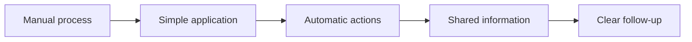
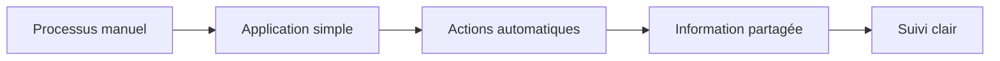

# Jefferson Mawapanga Saku — Power Platform Portfolio

[GitHub profile](https://github.com/jeffersonkuku) · [Power BI portfolio](https://github.com/jeffersonkuku/powerbi-portfolio-projects) · [LinkedIn](https://www.linkedin.com/in/jefferson-mawapanga-saku-604b72191/) · [Malt](https://www.malt.com/profile/jeffersonmawapanga)

---

## 🇬🇧 English

### 30-second overview

I use Microsoft Power Platform to turn **manual business processes** into simple applications and automated workflows.

<table>
<tr>
<td width="50%" valign="top">

 <strong>Ticketing & Request Management</strong> 
Goal: keep requests, owners, status, documents and e-mails in one place.
  <a href="./projects/power-platform-ticketing-system/"><strong>Open project →</strong></a>
</td>
<td width="50%" valign="top">

 <strong>Building Operations Hub</strong> 
Goal: guide a technician from the site to the correct equipment procedure.
  <a href="./projects/building-operations-hub/"><strong>Open project →</strong></a>
</td>
</tr>
</table>

### Other personal projects

- **[RoadWords AU](./roadwords-au/)**
- **[Native English Coach](./native-english-coach/)**

---

## 🇫🇷 Français

### Vue en 30 secondes

J’utilise Microsoft Power Platform pour transformer des **processus métiers manuels** en applications simples et workflows automatisés.

| Projet | Objectif |
|---|---|
| **[Ticketing & gestion des demandes](./projects/power-platform-ticketing-system/)** | Regrouper demande, responsable, statut, documents et e-mails au même endroit |
| **[Building Operations Hub](./projects/building-operations-hub/)** | Guider le technicien du site jusqu’à la bonne procédure équipement |

### Autres projets personnels

- **[RoadWords AU](./roadwords-au/)**
- **[Native English Coach](./native-english-coach/)**

---

Les détails techniques sont volontairement placés **dans chaque projet**, pas sur cette page d’accueil.
