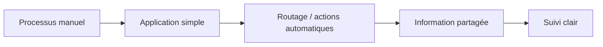

# Jefferson Mawapanga Saku — Power Platform Portfolio

[GitHub profile](https://github.com/jeffersonkuku) · [Power BI portfolio](https://github.com/jeffersonkuku/powerbi-portfolio-projects) · [LinkedIn](https://www.linkedin.com/in/jefferson-mawapanga-saku-604b72191/) · [Malt](https://www.malt.com/profile/jeffersonmawapanga)

---

## 🇬🇧 English

### 30-second overview

I use Microsoft Power Platform to turn **manual business processes** into simple applications and automated workflows.

### Main projects

#### Ticketing & Request Management

**Goal:** stop losing requests between e-mails, documents and teams.

**[Open project →](./projects/power-platform-ticketing-system/)** · **[Video →](https://www.youtube.com/watch?v=_jR8T9s2VUE)**

#### Building Operations Hub

**Goal:** help a technician find the right equipment procedure or contact quickly.

**[Open project →](./projects/building-operations-hub/)** · **[Video →](https://www.youtube.com/watch?v=Y15BCn_i-fo)**

### Other personal projects

- **[RoadWords AU](./roadwords-au/)** — vocabulary learning with Australian pronunciation.
- **[Native English Coach](./native-english-coach/)** — audio-first English practice.

**[See all projects →](./projects/README.md)**

---

## 🇫🇷 Français

### Vue en 30 secondes

J’utilise Microsoft Power Platform pour transformer des **processus métiers manuels** en applications simples et workflows automatisés.

### Projets principaux

#### Ticketing & gestion des demandes

**Objectif :** éviter que les demandes se perdent entre les e-mails, les documents et les équipes.

**[Voir le projet →](./projects/power-platform-ticketing-system/)** · **[Vidéo →](https://www.youtube.com/watch?v=_jR8T9s2VUE)**

#### Building Operations Hub

**Objectif :** aider un technicien à trouver rapidement la bonne procédure ou le bon contact.

**[Voir le projet →](./projects/building-operations-hub/)** · **[Vidéo →](https://www.youtube.com/watch?v=Y15BCn_i-fo)**

### Autres projets personnels

- **[RoadWords AU](./roadwords-au/)** — apprentissage du vocabulaire avec prononciation australienne.
- **[Native English Coach](./native-english-coach/)** — entraînement audio à l’anglais.

**[Voir tous les projets →](./projects/README.md)**

---

Les détails techniques sont volontairement placés **dans les pages projets**, pas sur cette page d’accueil.
