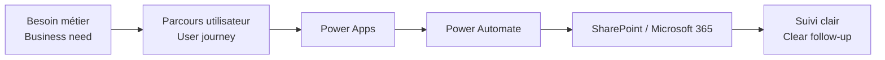
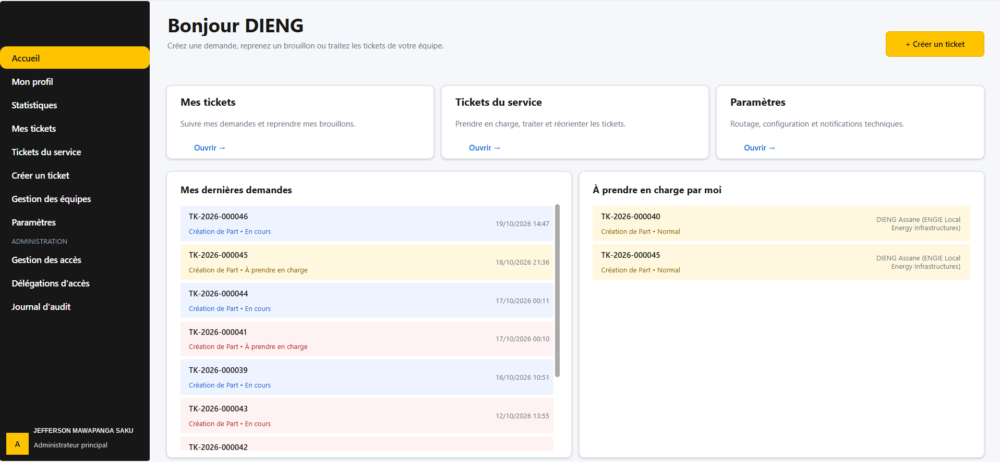
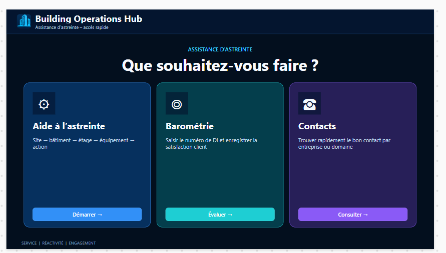
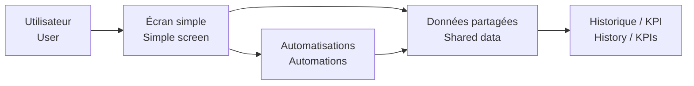

# Jefferson Mawapanga Saku — Power Platform Portfolio

[👤 Profil / Profile](https://github.com/jeffersonkuku) · [📊 Power BI](https://github.com/jeffersonkuku/powerbi-portfolio-projects) · [💼 LinkedIn](https://www.linkedin.com/in/jefferson-mawapanga-saku-604b72191/) · [🤝 Malt](https://www.malt.com/profile/jeffersonmawapanga)

> 🇫🇷 **Je construis des applications métiers et des automatisations qui remplacent les e-mails dispersés, les relances manuelles et les processus difficiles à suivre.**  
> *🇬🇧 I build business applications and automations that replace scattered e-mails, manual follow-up and hard-to-track processes.*

## ⚡ Comprendre en 30 secondes / Understand in 30 seconds

## 🧩 Projets / Projects

<table><tr><td width="50%" valign="top"> <strong>Ticketing & Request Management</strong> 🇫🇷 Centraliser les demandes, affectations, documents, e-mails et historiques. <em>🇬🇧 Centralise requests, assignments, documents, e-mails and history.</em>  <code>Demande → équipe → traitement → clôture</code>  <a href="./projects/power-platform-ticketing-system/"><strong>Voir / Open →</strong></a> <a href="https://www.youtube.com/watch?v=_jR8T9s2VUE">▶ Démo / Demo</a></td><td width="50%" valign="top"> <strong>Building Operations Hub</strong> 🇫🇷 Guider les techniciens jusqu’à la bonne procédure équipement. <em>🇬🇧 Guide technicians to the right equipment procedure.</em>  <code>Site → bâtiment → équipement → action</code>  <a href="./projects/building-operations-hub/"><strong>Voir / Open →</strong></a> <a href="https://www.youtube.com/watch?v=Y15BCn_i-fo">▶ Démo / Demo</a></td></tr><tr><td width="50%" valign="top"> <strong>RoadWords AU</strong> 🇫🇷 Apprendre le vocabulaire par l’écoute d’une prononciation australienne réelle. <em>🇬🇧 Learn vocabulary through real Australian pronunciation.</em>  <code>Écouter → comprendre → répéter → réviser</code>  <a href="./roadwords-au/"><strong>Voir / Open →</strong></a></td><td width="50%" valign="top"> <strong>Native English Coach</strong> 🇫🇷 Automatiser la compréhension des blocs d’anglais natif par répétition audio. <em>🇬🇧 Build automatic recognition of native-English chunks through audio repetition.</em>  <code>Écouter → contexte → répéter → automatiser</code>  <a href="./native-english-coach/"><strong>Voir / Open →</strong></a></td></tr></table>

## 🧠 Ma logique de conception / My design logic

🇫🇷 Je commence par **ce que l’utilisateur doit réussir à faire**, puis je construis la donnée, l’automatisation et la sécurité autour de ce parcours.  
*🇬🇧 I start with **what the user needs to achieve**, then build data, automation and security around that journey.*

## 📚 Aller plus loin / Go deeper

🇫🇷 Chaque projet contient ensuite un parcours image par image, les règles métier, l’architecture, les automatisations et les choix de sécurité.  
*🇬🇧 Each project then contains an image-by-image walkthrough, business rules, architecture, automations and security choices.*

**Power Apps Canvas · Power Fx · Power Automate · SharePoint · Microsoft 365**
