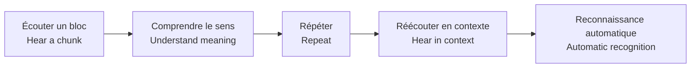
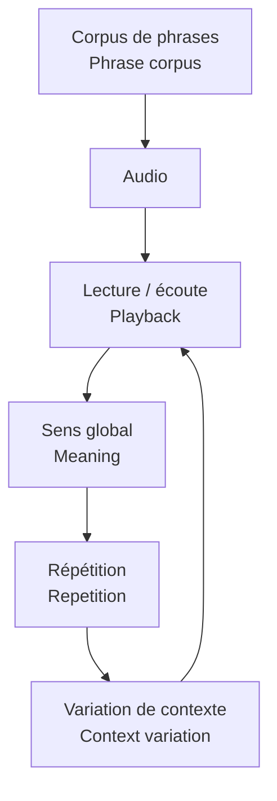
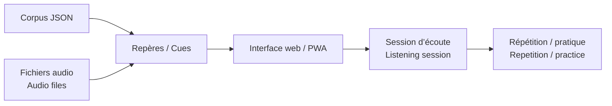

# Native English Coach

[← Portfolio](../README.md)

> 🇫🇷 **Une expérimentation audio pour arrêter de traduire chaque mot et commencer à reconnaître des blocs d’anglais natif comme des sons familiers.**  
> *🇬🇧 An audio-first experiment designed to reduce word-by-word translation and build recognition of native-English chunks as familiar sound patterns.*

## ⚡ Comprendre en 30 secondes / Understand in 30 seconds

**🇫🇷 Problème :** connaître le vocabulaire écrit ne suffit pas quand les mots sont réduits, liés ou prononcés très vite dans une phrase réelle.  
*🇬🇧 Problem: knowing written vocabulary is not enough when words are reduced, linked or spoken quickly in real sentences.*

**🇫🇷 Solution :** écouter une phrase naturelle, comprendre le bloc global, répéter le même son et le revoir dans plusieurs contextes.  
*🇬🇧 Solution: hear a natural phrase, understand the whole chunk, repeat the same sound and meet it again in multiple contexts.*

## 🎧 Ce que contient le projet / What the project contains

🇫🇷 Des corpus de phrases, du travail sur les verbes irréguliers, des audios longs, des versions mobiles et des fichiers de repères permettant de synchroniser texte et audio.  
*🇬🇧 Phrase corpora, irregular-verb material, long-form audio, mobile versions and cue/index files used to synchronise text and audio.*

## 🔄 Logique pédagogique / Learning logic

🇫🇷 Le but n’est pas de réciter de la grammaire, mais d’automatiser des formes courantes telles qu’elles sont réellement entendues.  
*🇬🇧 The goal is not to recite grammar rules, but to automate common forms as they are actually heard.*

## 📱 Interface et fonctionnement / Interface & operation

🇫🇷 Le dossier contient une interface web/PWA, des données JSON de cours, des fichiers audio, un service worker et des scripts de préparation.  
*🇬🇧 The folder contains a web/PWA interface, JSON course data, audio files, a service worker and preparation scripts.*

## 🧩 Architecture simplifiée / Simplified architecture

🇫🇷 Ce projet est un laboratoire d’apprentissage personnel, distinct des études de cas Power Platform d’entreprise.  
*🇬🇧 This is a personal learning experiment, separate from the enterprise Power Platform case studies.*
