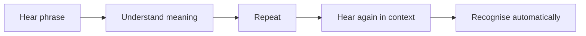
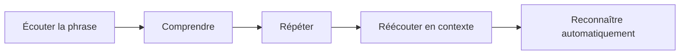

# Native English Coach

[← Portfolio](../README.md)

---

## 🇬🇧 English

### 20-second overview

An audio-first experiment for learning native English phrases by **hearing, understanding, repeating and recognising them automatically**.

The project includes phrase corpora, irregular verbs, long-form audio, mobile audio and a web/PWA interface.

---

## 🇫🇷 Français

### Vue en 20 secondes

Une expérimentation audio pour apprendre des phrases naturelles en anglais en les **écoutant, comprenant, répétant puis reconnaissant automatiquement**.

Le projet contient des corpus de phrases, verbes irréguliers, audios longs, versions mobiles et une interface web/PWA.
