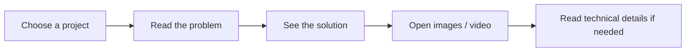

# Projects

[← Main portfolio](../README.md)

---

## 🇬🇧 English

### Choose a project

#### Ticketing & Request Management

**Problem:** requests are difficult to track across e-mails, documents and teams.  
**Solution:** one application for creation, assignment, processing, documents, e-mails and history.

**[Open project →](./power-platform-ticketing-system/)**

#### Building Operations Hub

**Problem:** technicians lose time looking for procedures, equipment knowledge and contacts.  
**Solution:** one application organised around the physical site and equipment journey.

**[Open project →](./building-operations-hub/)**

### Personal learning projects

- **[RoadWords AU](../roadwords-au/)**
- **[Native English Coach](../native-english-coach/)**

---

## 🇫🇷 Français

### Choisir un projet

#### Ticketing & gestion des demandes

**Problème :** les demandes sont difficiles à suivre entre les e-mails, documents et équipes.  
**Solution :** une seule application pour la création, l’affectation, le traitement, les documents, les e-mails et l’historique.

**[Voir le projet →](./power-platform-ticketing-system/)**

#### Building Operations Hub

**Problème :** les techniciens perdent du temps à chercher les procédures, informations équipements et contacts.  
**Solution :** une seule application organisée autour du parcours réel du site et de l’équipement.

**[Voir le projet →](./building-operations-hub/)**

### Projets personnels d’apprentissage

- **[RoadWords AU](../roadwords-au/)**
- **[Native English Coach](../native-english-coach/)**

