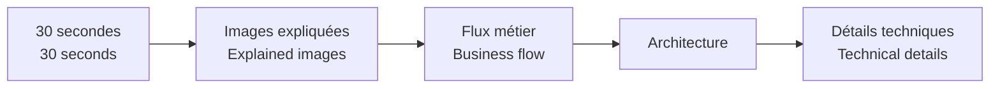

# Projets / Projects

[← Portfolio principal / Main portfolio](../README.md)

🇫🇷 Cette page donne un accès rapide aux quatre projets publics de ce dépôt.  
*🇬🇧 This page gives quick access to the four public projects in this repository.*

<table><tr><td width="50%" valign="top"> <strong>Ticketing & Request Management</strong> 🇫🇷 Centraliser les demandes, affectations, documents, e-mails et historiques. <em>🇬🇧 Centralise requests, assignments, documents, e-mails and history.</em>  <code>Demande → équipe → traitement → clôture</code>  <a href="./projects/power-platform-ticketing-system/"><strong>Voir / Open →</strong></a></td><td width="50%" valign="top"> <strong>Building Operations Hub</strong> 🇫🇷 Guider les techniciens jusqu’à la bonne procédure équipement. <em>🇬🇧 Guide technicians to the right equipment procedure.</em>  <code>Site → bâtiment → équipement → action</code>  <a href="./projects/building-operations-hub/"><strong>Voir / Open →</strong></a></td></tr><tr><td width="50%" valign="top"> <strong>RoadWords AU</strong> 🇫🇷 Apprendre le vocabulaire par l’écoute d’une prononciation australienne réelle. <em>🇬🇧 Learn vocabulary through real Australian pronunciation.</em>  <code>Écouter → comprendre → répéter → réviser</code>  <a href="./roadwords-au/"><strong>Voir / Open →</strong></a></td><td width="50%" valign="top"> <strong>Native English Coach</strong> 🇫🇷 Automatiser la compréhension des blocs d’anglais natif par répétition audio. <em>🇬🇧 Build automatic recognition of native-English chunks through audio repetition.</em>  <code>Écouter → contexte → répéter → automatiser</code>  <a href="./native-english-coach/"><strong>Voir / Open →</strong></a></td></tr></table>

## 🔎 Comment lire un projet / How to read a project

