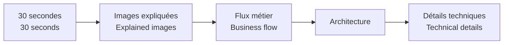

# Projets / Projects

[← Portfolio principal / Main portfolio](../README.md)

🇫🇷 Cette page donne un accès rapide aux deux applications Power Platform présentées dans ce portfolio.  
*🇬🇧 This page gives quick access to the two Power Platform applications presented in this portfolio.*

<table>
<tr>
<td width="50%" valign="top">

 <strong>Ticketing & Request Management</strong>
 🇫🇷 Centraliser demandes, affectations, documents, e-mails et historique.
 <em>🇬🇧 Centralise requests, assignments, documents, e-mails and history.</em>
  <code>Demande → équipe → traitement → clôture</code>
  <a href="./power-platform-ticketing-system/"><strong>Voir / Open →</strong></a>
</td>

<td width="50%" valign="top">

 <strong>Building Operations Hub</strong>
 🇫🇷 Guider les techniciens jusqu’à la bonne procédure équipement.
 <em>🇬🇧 Guide technicians to the right equipment procedure.</em>
  <code>Site → bâtiment → équipement → action</code>
  <a href="./building-operations-hub/"><strong>Voir / Open →</strong></a>
</td>
</tr>
</table>

## 🔎 Comment lire un projet / How to read a project

