# Building Operations Hub

[← Main portfolio](../../README.md) · [▶ Watch the demo](https://www.youtube.com/watch?v=Y15BCn_i-fo) · [🧭 All projects](../README.md)

> **A field application designed to help technicians find the right information without searching through several tools.**

## Understand it in 30 seconds

**Problem:** during an intervention, useful information can be spread across documents, contacts and people’s experience.

**Solution:** organise the application the same way the technician experiences the site:

**Site → Building → Floor / Zone → Equipment → Action / Tutorial**

**Why:** the user does not have to know where a document is stored. They only have to know **where they are and what equipment they are working on**.

**[▶ Watch the demo →](https://www.youtube.com/watch?v=Y15BCn_i-fo)**

## The idea in one diagram

\`\`\`mermaid
flowchart LR
    A[Choose site] --> B[Choose building]
    B --> C[Choose zone]
    C --> D[Choose equipment]
    D --> E[Choose action]
    E --> F[Open the right procedure / contact / knowledge]
\`\`\`

## What the user can do

- find a site, building, zone and equipment;
- open start, stop, configuration or troubleshooting guidance;
- search technical contacts;
- reuse lessons learned from previous interventions;
- propose useful technical content without publishing it directly;
- give post-intervention feedback.

## Visual walkthrough — click any image to open it

[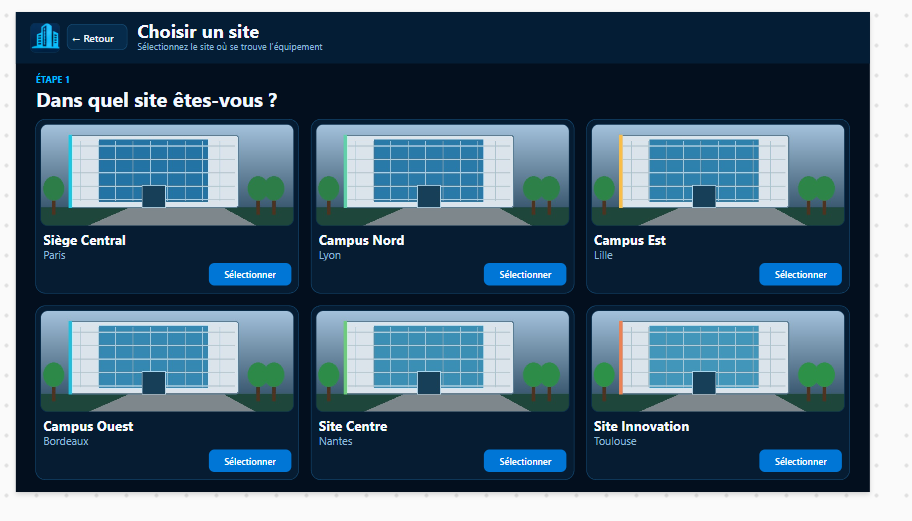](./assets/02-sites.png)

[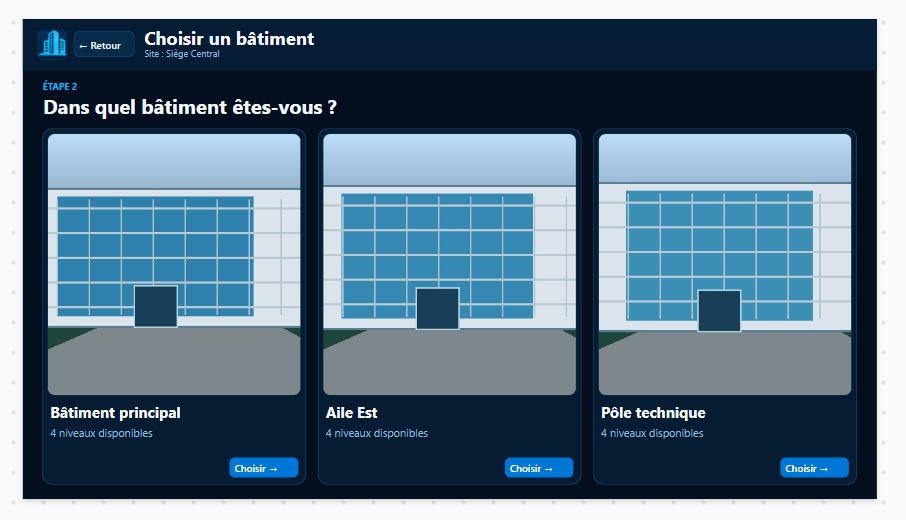](./assets/03-buildings.png)

[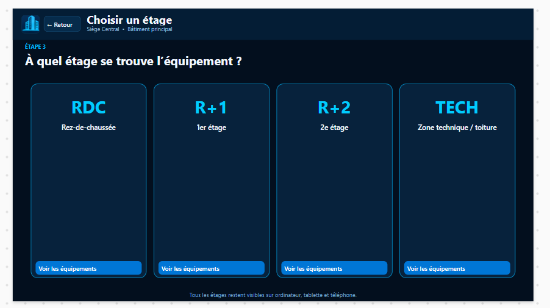](./assets/04-floors.png)

[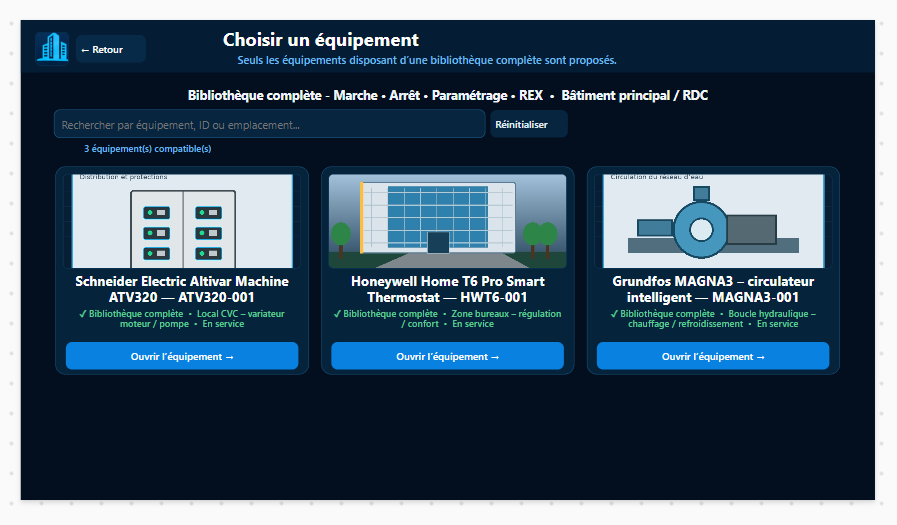](./assets/05-equipment-library.png)

[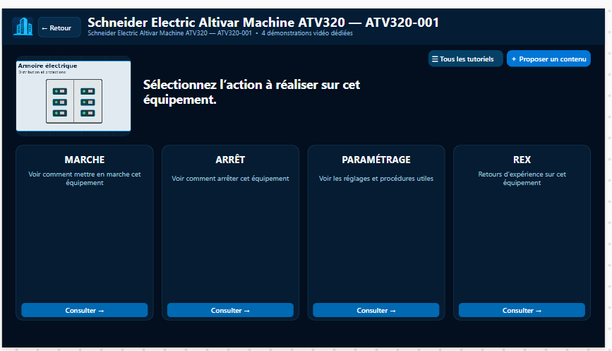](./assets/06-equipment-detail.png)

[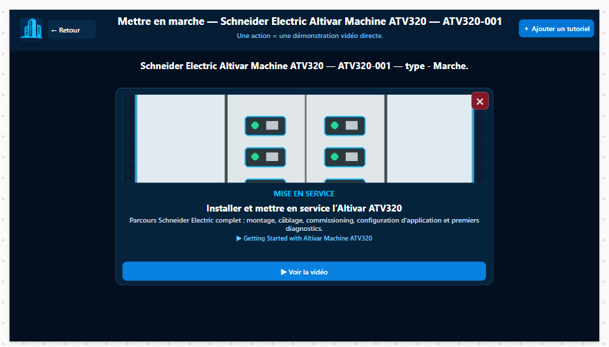](./assets/07-start-tutorial.png)

[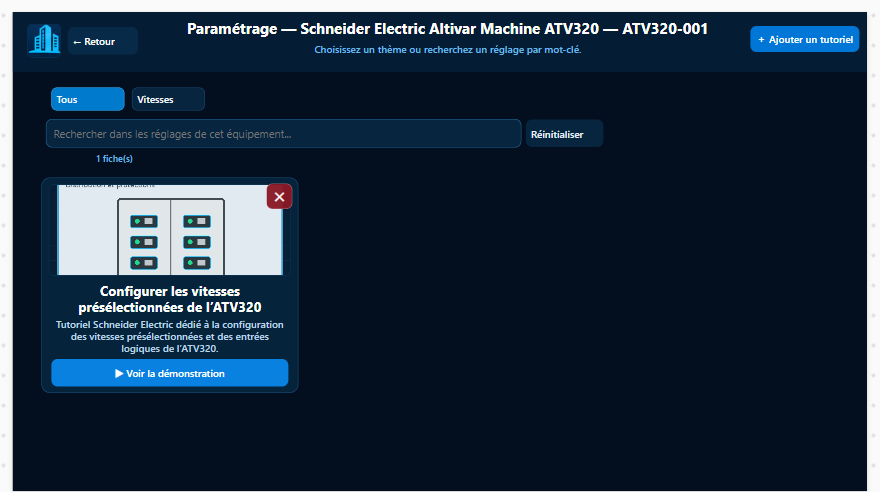](./assets/08-configuration.png)

[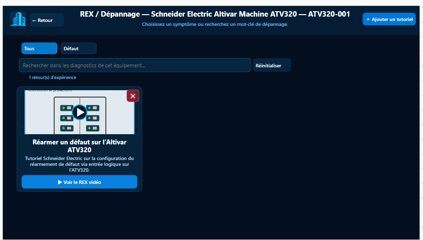](./assets/09-troubleshooting.png)

[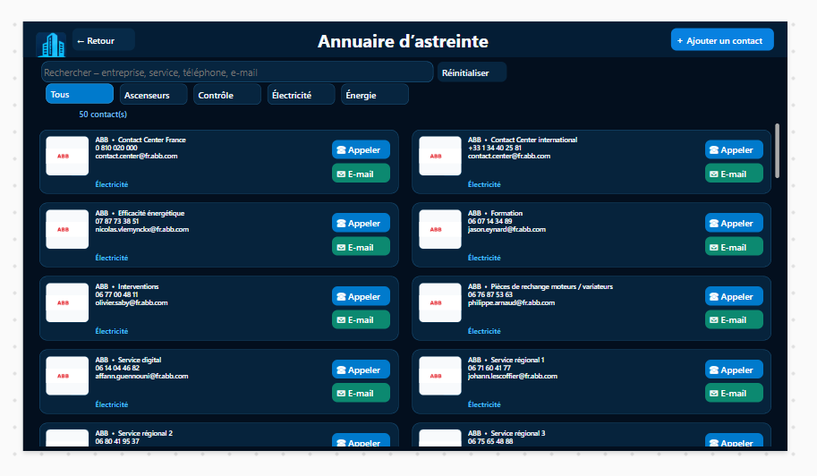](./assets/10-contacts.png)

[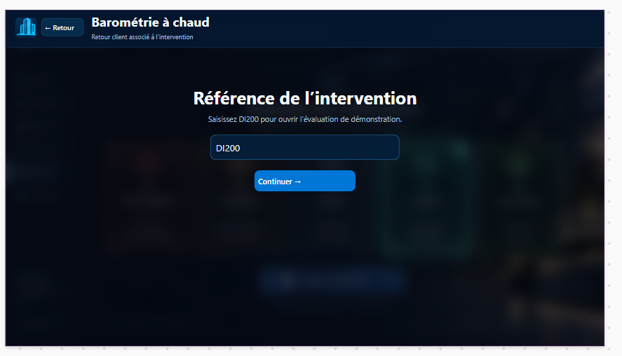](./assets/11-barometry-reference.png)

[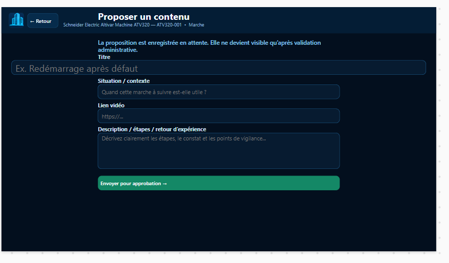](./assets/12-content-proposal.png)

[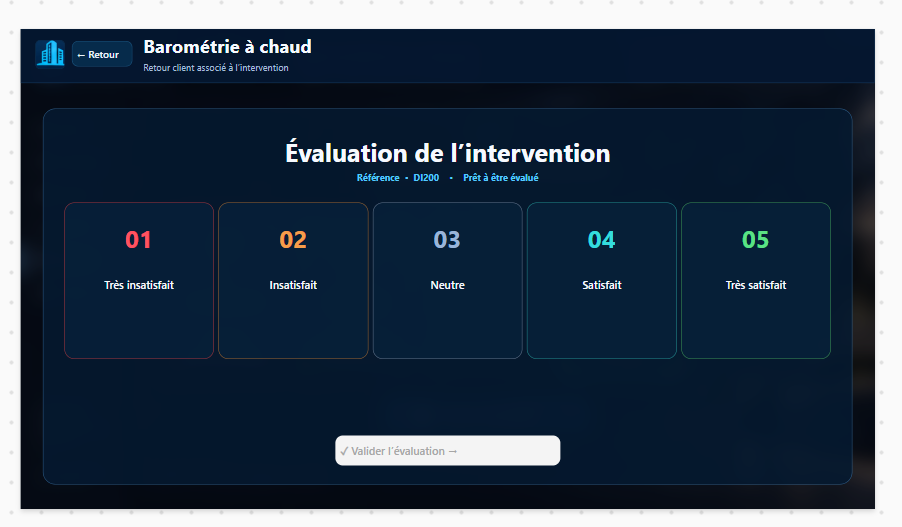](./assets/13-barometry-rating.png)

## How it works behind the screen

\`\`\`mermaid
flowchart TB
    U[Technician] --> APP[Power Apps]
    APP --> DATA[Equipment / contacts / knowledge]
    APP --> AUTO[Automation]
    AUTO --> APPROVAL[Validation / notifications]
    DATA --> REPORT[Operational feedback / reporting]
\`\`\`

<strong>Technical details</strong>

The case study uses Power Apps Canvas, Power Fx, SharePoint, Power Automate and Microsoft 365. The design also documents responsive layouts, controlled approval paths, role-based access principles, explicit error handling and DEV → TEST/UAT → PROD deployment.

- [Architecture](./docs/ARCHITECTURE.md)
- [Security & approvals](./docs/SECURITY_AND_APPROVALS.md)
- [User journey](./docs/USER_JOURNEY.md)
- [Demo notes](./demo/README.md)

## 🇫🇷 Résumé rapide

**Problème :** un technicien peut perdre du temps à chercher une procédure, une information équipement ou le bon contact.

**Solution :** l’application suit le parcours réel **Site → Bâtiment → Zone → Équipement → Action**, puis affiche l’information utile dans ce contexte.
