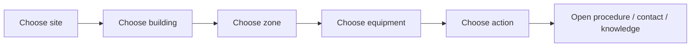
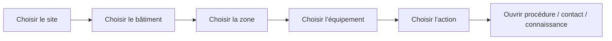

# Building Operations Hub

[← Portfolio](../../README.md) · [▶ Demo](https://www.youtube.com/watch?v=Y15BCn_i-fo)

---

## 🇬🇧 English

### Understand the project in 30 seconds

**Problem:** during an intervention, technicians may waste time searching through documents, contacts and people’s experience.

**Solution:** one field application organised like the real physical environment.

**Site → Building → Zone → Equipment → Action**

### How it works

### What the user can do

- find the right equipment;
- open start, stop, configuration or troubleshooting procedures;
- find technical contacts;
- reuse lessons learned;
- propose new technical content;
- leave post-intervention feedback.

### Visual journey

### Want the technical detail?

- **[Architecture →](./docs/ARCHITECTURE.md)**
- **[User journey →](./docs/USER_JOURNEY.md)**
- **[Security & approvals →](./docs/SECURITY_AND_APPROVALS.md)**

---

## 🇫🇷 Français

### Comprendre le projet en 30 secondes

**Problème :** pendant une intervention, un technicien peut perdre du temps à chercher dans des documents, des contacts ou l’expérience des autres.

**Solution :** une seule application terrain organisée comme l’environnement physique réel.

**Site → Bâtiment → Zone → Équipement → Action**

### Fonctionnement

### Ce que l’utilisateur peut faire

- retrouver le bon équipement ;
- ouvrir les procédures marche, arrêt, paramétrage ou dépannage ;
- trouver les contacts techniques ;
- réutiliser les retours d’expérience ;
- proposer un nouveau contenu technique ;
- donner un retour après intervention.

### Parcours visuel

Les captures ci-dessus suivent exactement ce parcours et sont cliquables pour être ouvertes en grand.

### Pour aller plus loin techniquement

- **[Architecture →](./docs/ARCHITECTURE.md)**
- **[Parcours utilisateur →](./docs/USER_JOURNEY.md)**
- **[Sécurité & validations →](./docs/SECURITY_AND_APPROVALS.md)**
