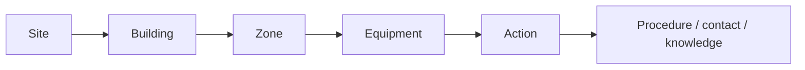
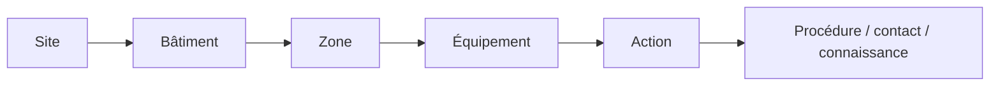

# Building Operations Hub

[← Portfolio](../../README.md) · [▶ Demo](https://www.youtube.com/watch?v=Y15BCn_i-fo)

---

## 🇬🇧 English

### Understand the project in 30 seconds

**Problem:** during an intervention, technicians can waste time searching through documents, contacts and people’s experience.

**Solution:** one field application organised like the real physical environment.

**Site → Building → Zone → Equipment → Action**

### Visual gallery — click to enlarge

<table>
<tr>
<td width="33%"> <b>Home</b></td>
<td width="33%"> <b>Sites</b></td>
<td width="33%"> <b>Buildings</b></td>
</tr>
<tr>
<td> <b>Zones</b></td>
<td> <b>Equipment</b></td>
<td> <b>Actions</b></td>
</tr>
<tr>
<td> <b>Start procedure</b></td>
<td> <b>Configuration</b></td>
<td> <b>Troubleshooting</b></td>
</tr>
<tr>
<td> <b>Contacts</b></td>
<td> <b>Intervention reference</b></td>
<td> <b>Content proposal</b></td>
</tr>
<tr>
<td> <b>Feedback</b></td>
<td></td><td></td>
</tr>
</table>

### What the user can do

Find the right equipment → open the right procedure → find the right contact → reuse or propose knowledge → leave feedback.

### Technical detail

- **[Architecture →](./docs/ARCHITECTURE.md)**
- **[User journey →](./docs/USER_JOURNEY.md)**
- **[Security & approvals →](./docs/SECURITY_AND_APPROVALS.md)**

---

## 🇫🇷 Français

### Comprendre le projet en 30 secondes

**Problème :** pendant une intervention, un technicien peut perdre du temps à chercher dans des documents, des contacts ou l’expérience des autres.

**Solution :** une seule application terrain organisée comme l’environnement physique réel.

**Site → Bâtiment → Zone → Équipement → Action**

### Galerie

Les **13 captures ci-dessus** sont cliquables pour être ouvertes en grand.

### Ce que l’utilisateur peut faire

Trouver le bon équipement → ouvrir la bonne procédure → trouver le bon contact → réutiliser ou proposer une connaissance → laisser un retour.

### Détail technique

- **[Architecture →](./docs/ARCHITECTURE.md)**
- **[Parcours utilisateur →](./docs/USER_JOURNEY.md)**
- **[Sécurité & validations →](./docs/SECURITY_AND_APPROVALS.md)**
