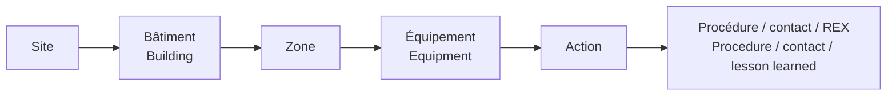
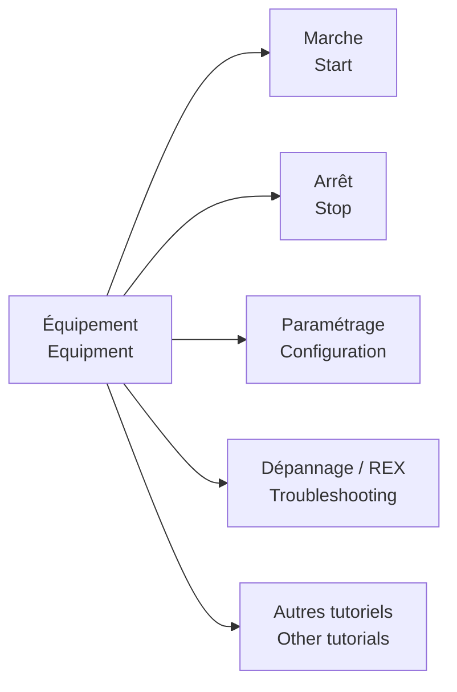
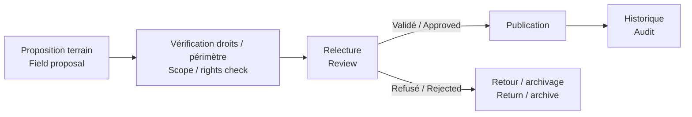
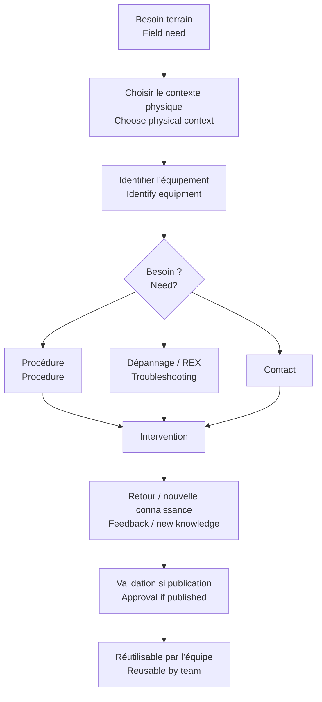
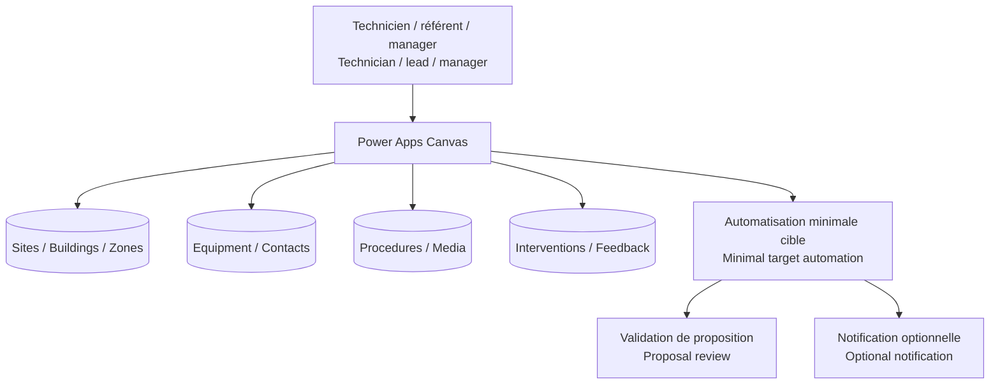
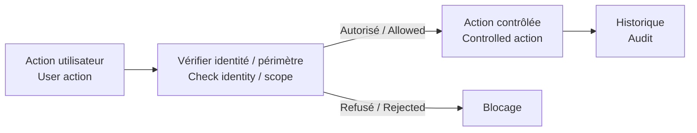

# Building Operations Hub

[← Portfolio](../../README.md) · [📚 Documentation complète / Complete documentation](./docs/README.md)

> 🇫🇷 **Une application terrain qui guide un technicien depuis le site jusqu’à la bonne procédure, au bon contact ou au bon retour d’expérience.**  
> *🇬🇧 A field application that guides a technician from the site to the right procedure, contact or reusable lesson learned.*

## ⚡ Comprendre en 30 secondes / Understand in 30 seconds

**🇫🇷 Problème :** les procédures, informations équipements, contacts et retours terrain sont dispersés et difficiles à retrouver rapidement pendant une intervention.  
*🇬🇧 Problem: procedures, equipment information, contacts and field knowledge are scattered and difficult to find quickly during an intervention.*

**🇫🇷 Solution :** organiser l’application exactement comme le terrain : **Site → Bâtiment → Zone → Équipement → Action**.  
*🇬🇧 Solution: organise the application exactly like the field environment: **Site → Building → Zone → Equipment → Action**.*

**🇫🇷 Résultat :** le technicien n’a pas besoin de savoir où sont stockés les fichiers ; il suit simplement le contexte réel de son intervention.  
*🇬🇧 Result: the technician does not need to know where files are stored; they simply follow the real intervention context.*

# Parcours complet image par image / Full image-by-image walkthrough

## 1. Accueil opérationnel / Operations hub

🇫🇷 L’accueil regroupe les grands usages terrain : aide à l’astreinte, retour après intervention et accès aux contacts techniques. L’utilisateur part d’un besoin métier, pas d’un dossier ou d’une bibliothèque SharePoint.  
*🇬🇧 The home page groups the main field use cases: on-call assistance, post-intervention feedback and technical contacts. The user starts from a business need, not from a SharePoint folder or library.*

## 2. Choix du site / Site selection

🇫🇷 Le technicien sélectionne d’abord le site concerné. Ce choix devient le contexte de navigation et évite d’afficher des équipements qui n’ont rien à voir avec l’intervention.  
*🇬🇧 The technician first selects the relevant site. This becomes the navigation context and avoids showing equipment unrelated to the intervention.*

## 3. Choix du bâtiment / Building selection

🇫🇷 Le bâtiment affine le contexte sans perdre le site sélectionné. L’application reproduit ainsi la logique physique réelle au lieu d’obliger l’utilisateur à connaître la structure des données.  
*🇬🇧 The building narrows the context without losing the selected site. The app mirrors the real physical hierarchy instead of forcing the user to know the data structure.*

## 4. Étage ou zone technique / Floor / technical zone

🇫🇷 Le parcours descend ensuite au niveau de l’étage ou de la zone technique. Cela réduit progressivement le volume d’informations jusqu’au périmètre utile.  
*🇬🇧 The journey then moves down to the floor or technical zone. This progressively narrows the information to the useful scope.*

## 5. Bibliothèque équipements / Equipment library

🇫🇷 La bibliothèque permet de rechercher ou filtrer les équipements du contexte sélectionné. Le technicien retrouve l’équipement à partir du terrain plutôt qu’à partir d’un nom de fichier.  
*🇬🇧 The library lets the technician search or filter equipment within the selected context. Equipment is found from the field context rather than from a file name.*

## 6. Hub d’actions équipement / Equipment action hub

🇫🇷 Une fois l’équipement ouvert, l’utilisateur choisit ce qu’il cherche : marche, arrêt, paramétrage, dépannage/REX ou autre tutoriel. L’équipement devient le point de départ de toute la connaissance associée.  
*🇬🇧 Once the equipment is opened, the user chooses what is needed: start, stop, configuration, troubleshooting/lessons learned or another tutorial. The equipment becomes the starting point for all related knowledge.*

## 7. Procédure de mise en service / Start / commissioning procedure

🇫🇷 La procédure est directement liée à l’équipement et à l’action choisie. Le technicien n’a donc pas à parcourir un document générique pour trouver la bonne section.  
*🇬🇧 The procedure is directly linked to the selected equipment and action. The technician does not need to search a generic document for the correct section.*

## 8. Bibliothèque de paramétrage / Configuration library

🇫🇷 Plusieurs tutoriels de paramétrage peuvent coexister pour le même équipement. Ils restent recherchables séparément afin de couvrir différents cas d’usage.  
*🇬🇧 Several configuration tutorials can coexist for the same equipment. They remain independently searchable to cover different use cases.*

## 9. Dépannage et retour d’expérience / Troubleshooting & lessons learned

🇫🇷 Les solutions trouvées sur le terrain peuvent être structurées comme connaissance réutilisable. L’objectif est d’éviter que le diagnostic reste dans un e-mail, un carnet ou uniquement dans la mémoire d’un technicien.  
*🇬🇧 Solutions found in the field can be structured as reusable knowledge. The goal is to avoid keeping troubleshooting only in an e-mail, notebook or one technician’s memory.*

## 10. Annuaire technique / Technical contact directory

🇫🇷 L’annuaire permet de retrouver rapidement la bonne entreprise, le bon service, le numéro de téléphone ou l’adresse e-mail selon le contexte technique.  
*🇬🇧 The directory helps users quickly find the right company, service, phone number or e-mail address for the technical context.*

## 11. Référence d’intervention / Intervention reference

🇫🇷 Avant de laisser un retour, l’utilisateur rattache son avis à une intervention. Cela permet de conserver un contexte exploitable dans le reporting au lieu d’avoir une note isolée.  
*🇬🇧 Before leaving feedback, the user links it to an intervention. This keeps useful reporting context instead of creating an isolated rating.*

## 12. Proposition de contenu technique / Technical-content proposal

🇫🇷 Un utilisateur peut proposer une nouvelle connaissance sans la publier directement. La proposition entre dans un processus de validation afin de protéger la qualité du référentiel.  
*🇬🇧 A user can propose new knowledge without publishing it directly. The proposal enters a validation process to protect the quality of the knowledge base.*

## 13. Retour après intervention / Post-intervention feedback

🇫🇷 Une note simple permet de capturer le ressenti immédiatement après l’intervention. Ces données peuvent ensuite alimenter l’analyse de performance et l’amélioration du service.  
*🇬🇧 A simple rating captures feedback immediately after the intervention. This data can then support performance analysis and service improvement.*

---

# 🔄 Fonctionnement métier global / Overall business flow

# 🧩 Architecture cible de l’application / Target application architecture

**🇫🇷 Power Apps** porte l’essentiel du produit : navigation, contexte physique, recherche, formulaires, rôles UX, messages, responsive et états.  
*🇬🇧 Power Apps owns most of the product: navigation, physical context, search, forms, UX roles, messages, responsive behaviour and state.*

**🇫🇷 SharePoint** sert de référentiel pour sites, bâtiments, zones, équipements, contacts, procédures, interventions, feedback et propositions.  
*🇬🇧 SharePoint acts as the reference store for sites, buildings, zones, equipment, contacts, procedures, interventions, feedback and proposals.*

**🇫🇷 Power Automate** reste volontairement limité à quelques traitements cibles utiles, principalement la validation d’une proposition de contenu et éventuellement une notification critique.  
*🇬🇧 Power Automate is intentionally limited to a few useful target processes, mainly content-proposal approval and optionally critical notifications.*

> 🇫🇷 **Transparence :** cette partie décrit la conception cible simulée lorsque l’automatisation n’a pas été livrée dans le package public.  
> *🇬🇧 **Transparency:** this section describes the simulated target design where automation was not delivered in the public package.*

# 🛡️ Sécurité et validation / Security & approval

🇫🇷 Les propriétés d’interface comme `Visible` ou `DisplayMode` servent à l’UX, pas comme unique frontière de sécurité. Les actions sensibles doivent être validées côté source ou flow.  
*🇬🇧 UI properties such as `Visible` or `DisplayMode` are UX controls, not the only security boundary. Sensitive actions should be validated at the source or flow layer.*

# 📱 Conception responsive / Responsive design

🇫🇷 Le parcours est pensé pour desktop, tablette et mobile afin que la navigation reste utilisable sur le terrain.  
*🇬🇧 The journey is designed for desktop, tablet and mobile so navigation remains usable in the field.*

# 📚 Documentation complète de l’application / Complete application documentation

| Lien / Link | Ce que vous trouverez / What you will find |
|---|---|
| **[Index documentation](./docs/README.md)** | tous les liens du projet / all project documentation links |
| **[Catalogue complet de l’application / Full application catalogue](./docs/APPLICATION_CATALOG.md)** | écrans, navigation, états, dépendances, recherche, responsive |
| **[Parcours utilisateurs / User journeys](./docs/USER_JOURNEY.md)** | technicien, référent, manager, administrateur |
| **[Modèle de données cible / Target data model](./docs/DATA_MODEL.md)** | sites, bâtiments, zones, équipements, contenus, contacts, feedback |
| **[Rôles & messages applicatifs / Roles & application messages](./docs/ROLES_AND_MESSAGES.md)** | rôles, accès UX, messages chargement/succès/erreur |
| **[Architecture cible / Target architecture](./docs/ARCHITECTURE.md)** | Power Apps + SharePoint + automatisation minimale simulée |
| **[Sécurité & validation / Security & approvals](./docs/SECURITY_AND_APPROVALS.md)** | permissions, publication contenu, suppression, documents |

---

🇫🇷 Cette étude de cas publique est anonymisée : packages de production, identifiants tenant, données confidentielles, contacts réels et détails de connexion ne sont pas publiés.  
*🇬🇧 This public case study is sanitised: production packages, tenant identifiers, confidential data, real contacts and connection details are not published.*
