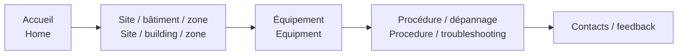

# Démonstration Building Operations Hub / Demo

[← Projet / Project](../README.md)

**🇫🇷 Voir la démonstration :** [YouTube](https://www.youtube.com/watch?v=Y15BCn_i-fo)  
*🇬🇧 Watch the demo: [YouTube](https://www.youtube.com/watch?v=Y15BCn_i-fo)*

