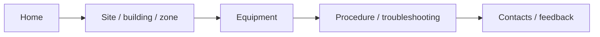
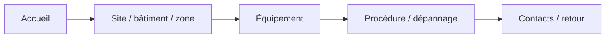

# Building Operations Hub — Demo

[← Project](../README.md)

---

## 🇬🇧 English

**[▶ Watch the full demo](https://www.youtube.com/watch?v=Y15BCn_i-fo)**

---

## 🇫🇷 Français

**[▶ Voir la démonstration complète](https://www.youtube.com/watch?v=Y15BCn_i-fo)**

