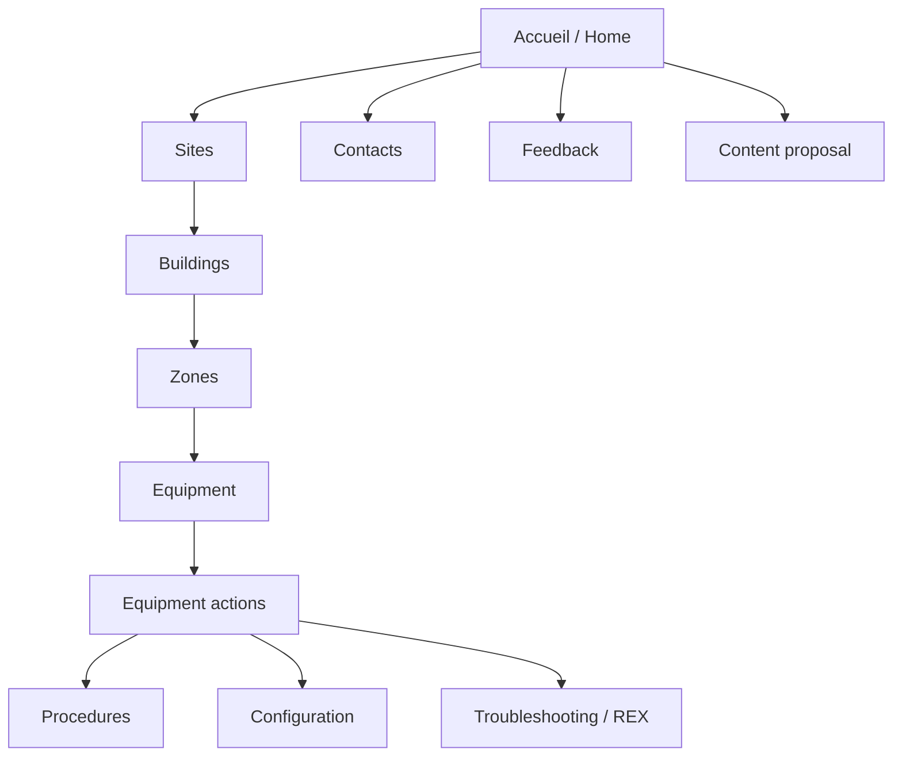
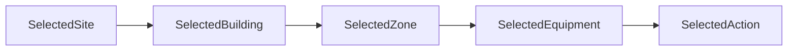
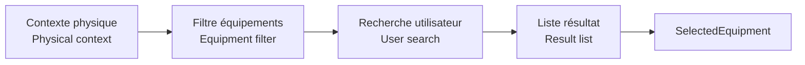
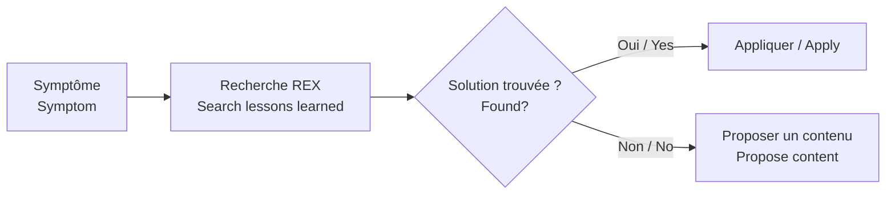
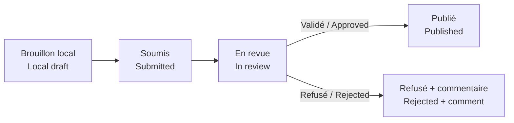
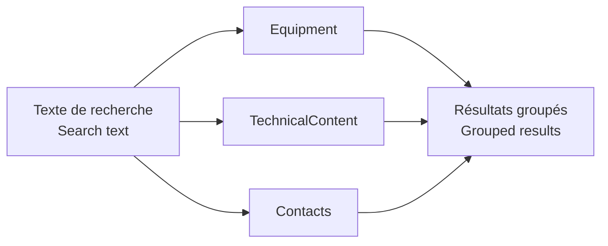
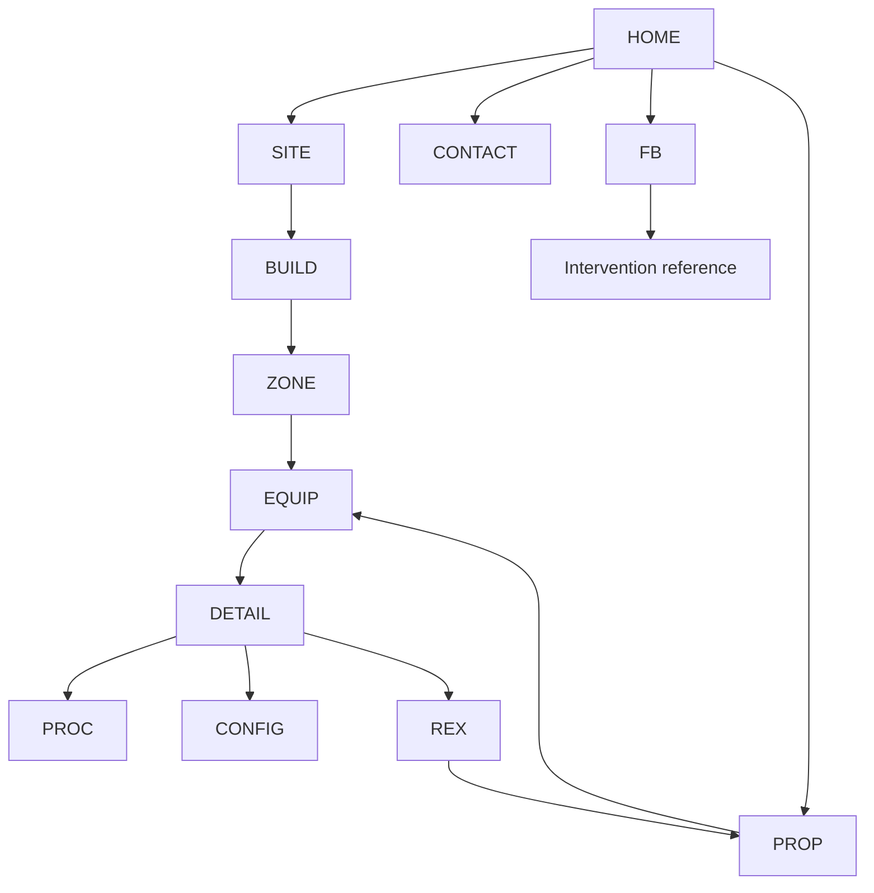

# Catalogue complet de l’application / Full Application Catalogue

[← Projet](../README.md) · [Documentation](./README.md)

> 🇫🇷 Cette page décrit **comment l’application Building Operations Hub devait fonctionner comme produit complet**, principalement côté Power Apps.  
> *🇬🇧 This page describes **how Building Operations Hub was intended to work as a complete product**, primarily on the Power Apps side.*

## 1. Structure générale / Overall structure

## 2. État de navigation / Navigation state

🇫🇷 L’application conserve un contexte de navigation pour éviter de redemander les mêmes informations à chaque écran.  
*🇬🇧 The app keeps navigation context so users do not have to reselect the same information on every screen.*

### Variables cibles / Target state
- `SelectedSite`
- `SelectedBuilding`
- `SelectedZone`
- `SelectedEquipment`
- `SelectedAction`
- `SearchText`
- `CurrentUserRole`
- `IsLoading`
- `LastError`

## 3. Écran Accueil / Home

**Objectif / Goal**  
🇫🇷 Donner immédiatement accès aux quatre besoins terrain : consulter un équipement, trouver un contact, signaler/proposer une information, laisser un feedback.  
*🇬🇧 Give immediate access to four field needs: inspect equipment, find a contact, report/propose information, leave feedback.*

**Affiche / Shows**
- raccourcis métier / business shortcuts;
- activité récente si disponible / recent activity if available;
- contexte utilisateur / user context;
- état de chargement / loading state.

**Navigation**
- Équipement → Sites
- Contact → Contacts
- Proposition → Content proposal
- Feedback → Feedback

## 4. Écran Sites / Sites screen

**Entrée / Input** : utilisateur depuis Accueil.  
**Lit / Reads** : table Sites.  
**Filtres / Filters** : recherche texte, statut actif, périmètre utilisateur si nécessaire.

**Sortie / Output** : `SelectedSite`.

**Cas vide / Empty state**  
🇫🇷 « Aucun site disponible pour votre périmètre. »  
*🇬🇧 “No site is available for your scope.”*

## 5. Écran Bâtiments / Buildings screen

**Dépend de / Depends on** : `SelectedSite`.  
**Lit / Reads** : Buildings filtrés par SiteId.  
**Sortie / Output** : `SelectedBuilding`.

🇫🇷 Le bouton Retour conserve le site sélectionné.  
*🇬🇧 Back navigation keeps the selected site.*

## 6. Écran Zones / Zones screen

**Dépend de** : Site + Building.  
**Lit** : Zones filtrées par BuildingId.  
**Sortie** : `SelectedZone`.

🇫🇷 Si un bâtiment n’a pas de niveau intermédiaire utile, la conception cible peut autoriser un passage direct aux équipements.  
*🇬🇧 If a building has no useful intermediate level, the target design can allow direct navigation to equipment.*

## 7. Bibliothèque équipements / Equipment library

**Dépend de** : Site/Building/Zone.  
**Fonctions**
- recherche nom/référence;
- filtre famille/type;
- filtre actif/inactif;
- ouverture détail;
- reset recherche;
- résultat vide explicite.

**Sortie** : `SelectedEquipment`.

## 8. Détail équipement / Equipment detail

🇫🇷 Cet écran est le **hub de connaissance**.  
*🇬🇧 This screen is the **knowledge hub**.*

### Actions cibles
- Marche / Start
- Arrêt / Stop
- Paramétrage / Configuration
- Dépannage / Troubleshooting
- REX / Lessons learned
- Autres tutoriels / Other tutorials
- Contacts liés / Related contacts

**Dépend de** : `SelectedEquipment`.  
**Sortie** : `SelectedAction`.

## 9. Lecteur de procédure / Procedure viewer

**Entrée** : équipement + action.  
**Lit** : TechnicalContent.  
**Affiche**
- titre;
- version;
- type;
- contenu;
- média/document;
- date de mise à jour;
- validation/publication.

**Messages**
- contenu indisponible;
- version remplacée;
- document non accessible;
- aucune procédure publiée.

## 10. Paramétrage / Configuration

🇫🇷 Plusieurs fiches peuvent être associées à un même équipement. L’utilisateur peut rechercher par titre ou catégorie et ouvrir celle adaptée à son besoin.  
*🇬🇧 Several configuration guides can be linked to the same equipment. Users can search by title or category and open the relevant one.*

## 11. Dépannage / REX

**But**
- capitaliser les incidents;
- retrouver une solution déjà utilisée;
- filtrer par symptôme/type;
- distinguer contenu publié et proposition en attente.

## 12. Contacts techniques / Technical contacts

**Filtres**
- site;
- bâtiment;
- métier/spécialité;
- entreprise;
- recherche nom.

**Actions**
- appeler;
- e-mail;
- copier les coordonnées;
- voir le contexte.

**Message vide**
« Aucun contact technique ne correspond à ces filtres. »  
*“No technical contact matches these filters.”*

## 13. Référence d’intervention / Intervention reference

🇫🇷 Avant feedback ou REX, l’utilisateur peut sélectionner une intervention afin de rattacher le retour à un contexte exploitable.  
*🇬🇧 Before feedback or lessons learned, users can select an intervention so the response has usable context.*

## 14. Proposition de contenu / Content proposal

### Formulaire cible
- site;
- équipement;
- type de contenu;
- titre;
- description;
- pièce/document;
- commentaire;
- auteur.

### Statuts

🇫🇷 Ici, une petite automatisation cible peut notifier un référent et enregistrer la décision. L’essentiel du projet reste toutefois l’application et son référentiel.  
*🇬🇧 A small target automation can notify a reviewer and record the decision. The core of the project remains the application and its knowledge base.*

## 15. Feedback / Barométrie

**Entrées**
- intervention;
- site;
- note;
- commentaire optionnel.

**Sortie**
- Feedback record;
- confirmation utilisateur.

**Message succès**
« Merci, votre retour a bien été enregistré. »  
*“Thank you, your feedback has been recorded.”*

## 16. Recherche globale cible / Target global search

🇫🇷 Une recherche globale peut agréger équipements, procédures et contacts tout en gardant le contexte sélectionné.  
*🇬🇧 A global search can aggregate equipment, procedures and contacts while preserving selected context.*

## 17. Chargements & erreurs / Loading & errors

### État de chargement
- overlay léger;
- désactivation des actions doublons;
- texte court;
- timeout géré.

### Erreurs
- réseau;
- accès refusé;
- contenu supprimé;
- donnée introuvable;
- sauvegarde échouée.

🇫🇷 Les erreurs doivent être compréhensibles sans afficher les détails techniques bruts au technicien.  
*🇬🇧 Errors should be understandable without exposing raw technical details to technicians.*

## 18. Responsive / Responsive behaviour

| Support | Comportement cible |
|---|---|
| Desktop | navigation complète + grilles |
| Tablette | navigation condensée + cartes |
| Mobile portrait | pile verticale + boutons tactiles |
| Mobile paysage | deux colonnes lorsque possible |

## 19. Dépendances entre écrans / Screen dependencies

## 20. Ce qui est simulé / What is simulated

🇫🇷 Le catalogue décrit la **solution cible** comme si l’application avait été finalisée avec tout son périmètre fonctionnel. Les écrans et parcours sont basés sur le projet présenté ; les mécanismes serveur non livrés publiquement sont explicitement traités comme conception cible.  
*🇬🇧 This catalogue describes the **target solution** as if the application had been completed across its full functional scope. Screens and journeys are based on the presented project; server-side mechanisms not publicly delivered are explicitly treated as target design.*
