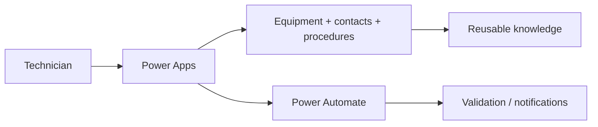
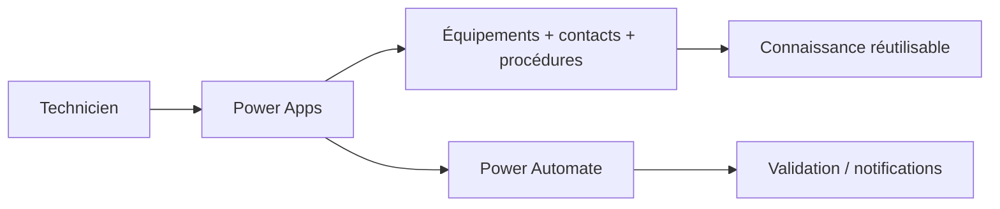

# Architecture — Building Operations Hub

[← Project](../README.md)

---

## 🇬🇧 English

### Simple view

The application guides the technician. Data stores the knowledge. Automation handles controlled actions.

---

## 🇫🇷 Français

### Vue simple

L’application guide le technicien. Les données conservent la connaissance. L’automatisation gère les actions contrôlées.
