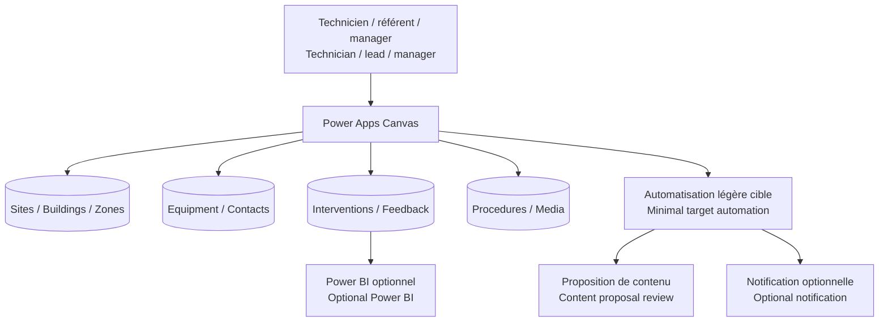

# Architecture cible — Building Operations Hub / Target Architecture

[← Projet](../README.md) · [Documentation](./README.md)

> 🇫🇷 L’architecture cible est volontairement **centrée sur l’application**, avec très peu d’automatisation.  
> *🇬🇧 The target architecture is intentionally **application-centred**, with minimal automation.*

## 1. Ce que fait Power Apps / What Power Apps owns

- navigation hiérarchique;
- recherche;
- filtres;
- sélection du contexte;
- lecture procédures;
- contacts;
- formulaire proposition;
- feedback;
- rôles UX;
- messages et erreurs;
- responsive.

## 2. Ce que fait SharePoint / What SharePoint owns

- référentiels;
- relations site/bâtiment/zone/équipement;
- métadonnées;
- documents;
- contacts;
- interventions;
- feedback;
- propositions.

## 3. Automatisation cible minimale / Minimal target automation

🇫🇷 Deux automatisations suffisent pour la conception cible :  
*🇬🇧 Two automations are enough for the target design:*

### A. ReviewContentProposal
- déclenchée à la soumission d’une proposition;
- notifie le référent;
- enregistre décision et commentaire;
- passe le contenu à Published si validé.

### B. NotifyCriticalFeedback (optionnelle)
- utilisée uniquement si une note très basse nécessite une alerte;
- ne bloque jamais l’enregistrement du feedback.

🇫🇷 Le reste doit rester dans Power Apps + SharePoint pour éviter de transformer une application de terrain en architecture inutilement complexe.  
*🇬🇧 Everything else should remain in Power Apps + SharePoint to avoid turning a field application into an unnecessarily complex architecture.*

## 4. Performance cible / Target performance

- filtrer par contexte avant d’afficher;
- éviter les Refresh globaux;
- charger les contacts/procédures à la demande;
- conserver les sélections utilisateur;
- limiter les collections locales aux données réellement utiles.
