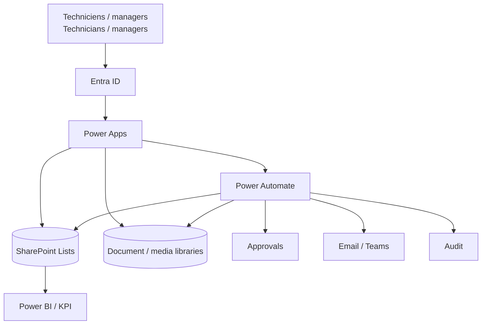

# Architecture — Building Operations Hub

[← Projet / Project](../README.md)

🇫🇷 **Power Apps** guide l’utilisateur et gère navigation, recherche et formulaires.  
*🇬🇧 **Power Apps** guides the user and manages navigation, search and forms.*

🇫🇷 **SharePoint** conserve équipements, contacts, métadonnées et contenus.  
*🇬🇧 **SharePoint** stores equipment, contacts, metadata and content.*

🇫🇷 **Power Automate** gère validations, notifications et actions contrôlées.  
*🇬🇧 **Power Automate** handles approvals, notifications and controlled actions.*

🇫🇷 **Power BI** exploite les données de feedback et de performance.  
*🇬🇧 **Power BI** uses feedback and performance data.*
