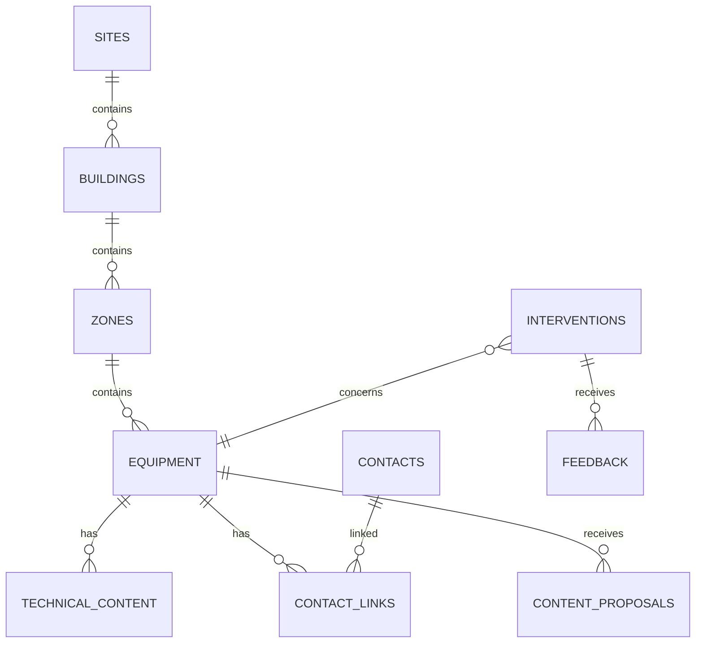

# Modèle de données cible / Target Data Model

[← Documentation](./README.md)

> 🇫🇷 Cette page est une **simulation de conception cible** du stockage nécessaire à l’application.  
> *🇬🇧 This page is a **target-design simulation** of the storage required by the application.*

## Entités principales / Main entities

### Sites
- Id
- Name
- Code
- Active
- Region/Location

### Buildings
- Id
- SiteId
- Name
- Code
- Active

### Zones
- Id
- BuildingId
- Name
- Floor/Type
- Active

### Equipment
- Id
- ZoneId
- Name
- Reference
- Family
- Type
- Status
- Criticality

### TechnicalContent
- Id
- EquipmentId
- ContentType
- Title
- Summary
- DocumentUrl
- Version
- Status
- PublishedAt
- UpdatedBy

### Contacts
- Id
- Name
- Company
- Specialty
- Phone
- Email
- Active

### ContactLinks
- EquipmentId / SiteId
- ContactId
- Priority

### Interventions
- Id
- EquipmentId
- Reference
- Date
- Status
- Technician

### Feedback
- InterventionId
- Rating
- Comment
- CreatedBy
- CreatedAt

### ContentProposals
- EquipmentId
- Type
- Title
- Description
- Attachment
- Status
- ReviewerComment
- CreatedBy
- ReviewedBy

## Bibliothèques / Libraries

### Procedures
🇫🇷 documents publiés et médias associés.  
*🇬🇧 published procedures and related media.*

### ProposalAttachments
🇫🇷 pièces déposées avec les propositions avant validation.  
*🇬🇧 files submitted with proposals before approval.*

## Règle centrale / Central rule

🇫🇷 La hiérarchie physique est stockée comme relation de données, pas codée en dur dans les écrans.  
*🇬🇧 The physical hierarchy is stored as data relationships, not hard-coded in screens.*
