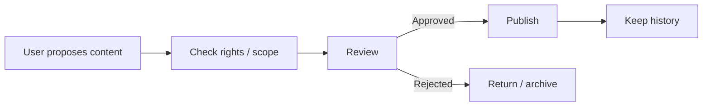
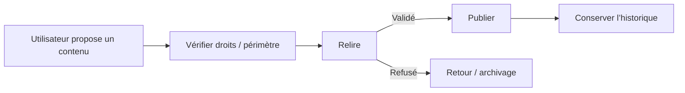

# Security & Approvals — Building Operations Hub

[← Project](../README.md)

---

## 🇬🇧 English

### Why approval exists

A technician can propose useful knowledge, but a proposal should not become official guidance immediately.

---

## 🇫🇷 Français

### Pourquoi une validation ?

Un technicien peut proposer une connaissance utile, mais une proposition ne doit pas devenir immédiatement une procédure officielle.

