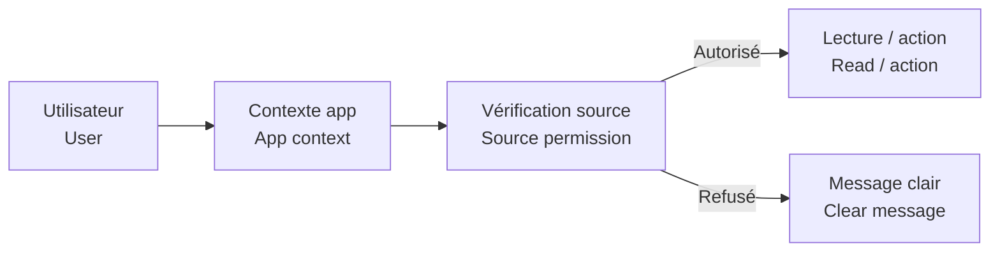

# Sécurité & validation — Building Operations Hub / Security & Approval

[← Documentation](./README.md)

> 🇫🇷 Cette page décrit la **conception cible**.  
> *🇬🇧 This page describes the **target design**.*

## 1. Sécurité

🇫🇷 Les rôles d’interface servent à présenter la bonne expérience, mais les données sensibles doivent également respecter les autorisations de la source.  
*🇬🇧 Interface roles shape the user experience, but sensitive data should also respect source permissions.*

## 2. Publication de contenu

🇫🇷 Un technicien peut proposer du contenu, mais seuls les rôles de validation peuvent le publier.  
*🇬🇧 A technician can propose content, but only review roles can publish it.*

## 3. Suppression

- confirmation obligatoire;
- journalisation recommandée;
- privilégier désactivation/archivage pour les référentiels critiques.

## 4. Documents

🇫🇷 Un lien affiché dans l’application ne doit pas contourner les permissions de la bibliothèque.  
*🇬🇧 A link displayed in the app must not bypass library permissions.*

## 5. Feedback

🇫🇷 Le feedback peut être visible en agrégé au management tout en limitant l’exposition des commentaires individuels selon le besoin métier.  
*🇬🇧 Feedback can be visible in aggregate to management while limiting exposure of individual comments according to business need.*
