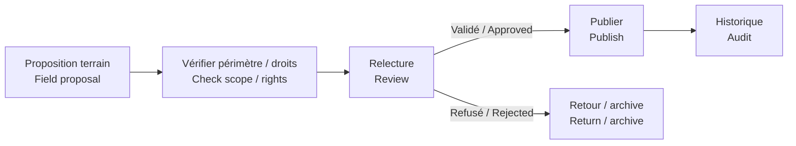

# Sécurité & validations / Security & Approvals

[← Projet / Project](../README.md)

## ✅ Validation d’un contenu / Content approval

🇫🇷 Une proposition terrain ne devient pas automatiquement une procédure officielle.  
*🇬🇧 A field proposal does not automatically become official guidance.*

🇫🇷 Les actions sensibles doivent être validées côté source/flow, pas uniquement cachées dans l’interface.  
*🇬🇧 Sensitive actions should be validated at the source/flow layer, not only hidden in the interface.*
