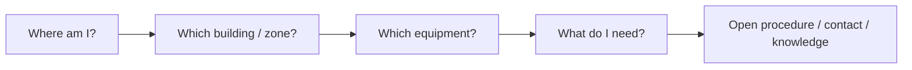
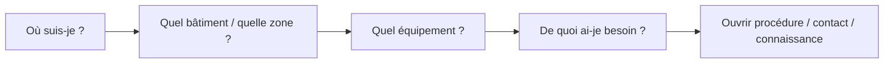

# User Journey — Building Operations Hub

[← Project](../README.md)

---

## 🇬🇧 English

The user does not need to know where files are stored. The application follows questions that make sense in the field.

---

## 🇫🇷 Français

L’utilisateur n’a pas besoin de savoir où sont stockés les fichiers. L’application suit des questions naturelles sur le terrain.
