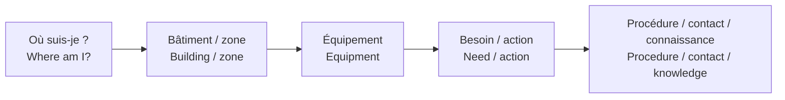

# Parcours utilisateur / User Journey

[← Projet / Project](../README.md)

🇫🇷 Le parcours suit des questions naturelles pour un technicien plutôt que l’emplacement technique des fichiers.  
*🇬🇧 The journey follows natural questions for a technician rather than the technical location of files.*

🇫🇷 Après l’intervention, l’utilisateur peut laisser un retour ou proposer une nouvelle connaissance.  
*🇬🇧 After the intervention, the user can leave feedback or propose new knowledge.*
