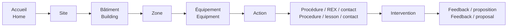
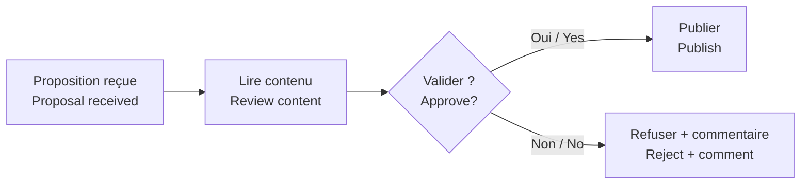

# Parcours utilisateurs — Building Operations Hub / User Journeys

[← Documentation](./README.md)

## Technicien / Technician

## Référent technique / Technical lead

## Manager

🇫🇷 Le manager consulte les retours, tendances et informations de contexte sans modifier les procédures métier.  
*🇬🇧 Managers review feedback, trends and contextual information without editing operational procedures.*

## Administrateur

🇫🇷 L’administrateur maintient le référentiel : sites, bâtiments, zones, équipements, contacts et paramètres de l’application.  
*🇬🇧 Administrators maintain the reference data: sites, buildings, zones, equipment, contacts and app settings.*

## Principe de navigation / Navigation principle

🇫🇷 L’utilisateur ne cherche jamais « dans SharePoint ». Il répond simplement à des questions terrain : où suis-je, sur quel équipement, que dois-je faire ?  
*🇬🇧 Users never “search SharePoint”. They simply answer field questions: where am I, which equipment, what do I need to do?*
