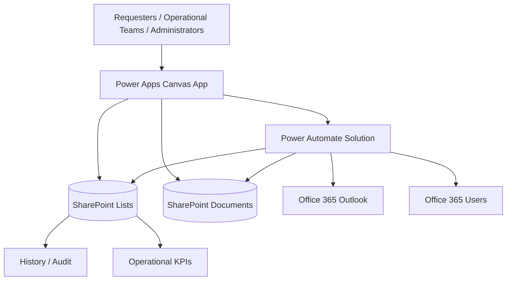

# Power Platform Ticketing & Request Management

> **Power Apps · Power Automate · SharePoint · Microsoft 365 · Outlook integration**

[← Main portfolio](../../README.md) · [▶ Watch the YouTube demo](https://www.youtube.com/watch?v=_jR8T9s2VUE) · [🇫🇷 Français](#francais)

## 30-second overview

**Business problem:** internal requests can become difficult to track when they are spread across e-mails, manual follow-ups, documents and disconnected team processes.

**Solution:** a Power Platform application that centralises request creation, drafts, team assignment, ticket processing, documents, Outlook conversation archiving, routing, notifications, delegations, administration and operational reporting.

**Stack:** Power Apps Canvas · Power Fx · Power Automate · SharePoint · Microsoft 365

**Current project scale documented from the supplied solution packages:**

- **28** Canvas screen definitions
- **27** Power Automate cloud flows
- **29** environment-variable definitions
- connection references for **SharePoint**, **Office 365 Outlook** and **Office 365 Users**
- no source package, tenant secret, production URL or confidential dataset is published here

### ▶ See it working

**[Watch the full demo on YouTube →](https://www.youtube.com/watch?v=_jR8T9s2VUE)**

---

## Product journey

### 1. Home dashboard

The landing page gives the user immediate access to personal tickets, service tickets, settings and the latest requests that need attention.

### 2. Personal profile, absences and delegation

Users can review their access context and manage personal absence/delegation information without exposing security decisions only through the interface.

### 3. Operational statistics

Team-level indicators provide visibility over open workload, tickets waiting for ownership, tickets in progress, waiting tickets, urgent tickets and backlog distribution.

### 4. My tickets

The personal workspace separates **drafts** from real submitted tickets. A draft remains a creation-in-progress until the final submission step is completed.

### 5. Service tickets

Operational teams can review incoming requests, take ownership, reassign work, change status and prioritise urgent items.

### 6. Request creation

The application supports six business journeys:

1. **Create a Part**
2. **Create a PO**
3. **Request a quotation / submission**
4. **Purchase outside catalogue**
5. **Follow an existing request**
6. **Other request**

### 7. Draft lifecycle

The application distinguishes system defaults from real user changes. A draft is only created or proposed when the user has actually changed business data or documents.

### 8. Documents

Documents are staged and associated with the request lifecycle without making the presence of a document equivalent to a submitted ticket.

### 9. Ticket detail

The ticket workspace centralises status, urgency, team, assignee, activity, comments, documents, linked e-mails and history.

### 10. Outlook conversation archiving

A user can attach an Outlook conversation to a ticket. The conversation is archived in SharePoint so ticket consultation does not depend on direct mailbox access.

### 11. Team, routing and access administration

Administrative screens cover teams, members, routing rules, access, temporary delegations, notification parameters and audit history.

---

## What this case study demonstrates

| Area | Evidence |
|---|---|
| **Power Apps** | Multi-screen Canvas application for requesters, operational teams and administrators |
| **Power Automate** | Solution-aware flows for routing, document lifecycle, notifications, ticket actions, Outlook archiving and administration |
| **SharePoint** | Business records, documents, ticket history, access data and configuration |
| **Microsoft 365** | Outlook and user-directory integration |
| **Draft management** | Separation between creation-in-progress and submitted operational tickets |
| **Routing** | Team assignment, ownership, reminders, reassignment and escalation logic |
| **Reliability** | Explicit error paths, idempotency considerations, controlled retries and audit history |
| **Performance** | Source-side filtering, reduced unnecessary refreshes, response-first patterns where safe, and bounded concurrency |
| **Accessibility** | Keyboard-focus work, accessible labels, visible focus and responsive layouts |
| **ALM** | Solution-aware flows, connection references and environment variables for deployment across environments |

---

## Architecture

### Responsibility split

- **Power Apps** — responsive UX, forms, navigation, draft experience and operational interaction.
- **SharePoint** — business records, documents, configuration, history and access-related data.
- **Power Automate** — server-side validation, routing, mutations, notifications, document handling, Outlook archiving and scheduled processing.
- **Office 365 Outlook** — e-mail search, conversation archiving and notifications.
- **Office 365 Users** — user/profile resolution.

---

## Automation landscape

The supplied Power Automate solution contains **27 flows**. The public case study documents responsibilities without publishing the flow definitions.

### Ticket lifecycle
- ticket actions and status changes
- draft persistence
- initial transmission
- routing engine
- KPI calculation

### Documents
- document staging
- staging list/read/delete operations
- ticket document processing
- maintenance and retention

### Outlook & notifications
- search Outlook messages
- attach Outlook conversation
- synchronise archived conversations
- notification generation and delivery
- assignment notifications
- copy/subscriber notifications

### Administration
- teams and access
- routing rules
- application parameters
- notification settings
- profile absences/delegations
- SharePoint navigation/favourites

**[Open the flow catalogue →](./docs/FLOW_CATALOG.md)**

---

## Engineering & production approach

The solution is designed around these principles:

- server-side validation for sensitive actions;
- Power Apps visibility/display state is treated as UX, not the security boundary;
- SharePoint filtering and delegation are considered before local collection workarounds;
- draft state is separated from a real submitted ticket;
- document operations are explicit and traceable;
- potentially repeated operations are designed with duplicate/idempotency concerns in mind;
- concurrency is used only for independent work;
- routing/notification flows are structured to reduce unnecessary sequential network calls;
- error handling and auditability are part of the process design;
- environment-specific configuration is separated from flow logic through environment variables;
- deployment is designed around **DEV → TEST/UAT → PROD** rather than normal development directly in production.

### Microsoft references used for the ALM approach

- [Solutions overview](https://learn.microsoft.com/power-apps/maker/data-platform/solutions-overview)
- [Environment variables in Power Automate](https://learn.microsoft.com/en-us/power-automate/environment-variables)
- [Benefits of solution-aware cloud flows](https://learn.microsoft.com/en-us/power-automate/guidance/coding-guidelines/understand-benefits-solution-aware-flows)

---

## Documentation

- [Architecture](./docs/ARCHITECTURE.md)
- [Flow catalogue](./docs/FLOW_CATALOG.md)
- [Security, governance & ALM](./docs/SECURITY_GOVERNANCE.md)
- [User journey](./docs/USER_JOURNEY.md)
- [Demo notes](./demo/README.md)

---

## Public portfolio boundary

This repository is a **portfolio case study**, not a source-code distribution.

The following are intentionally **not published**:

- production `.msapp` packages;
- Power Fx implementation;
- Power Automate workflow JSON/source exports;
- tenant-specific URLs and identifiers;
- credentials, secrets and connection details;
- confidential business data;
- raw internal screenshots containing private branding or personal information.

The public material focuses on the **business problem, product journey, architecture, engineering choices and demonstrated capabilities**.

---

## Contact

- [LinkedIn](https://www.linkedin.com/in/jefferson-mawapanga-saku-604b72191/)
- [Malt](https://www.malt.com/profile/jeffersonmawapanga)
- [GitHub portfolio](https://github.com/jeffersonkuku/jefferson-Mawapanga-Saku)

Freelance Power Platform projects can be discussed from **€200**, depending on scope and requirements.

---

# 🇫🇷 Français

## Vue en 30 secondes

**Problème métier :** les demandes internes deviennent difficiles à suivre lorsqu'elles sont réparties entre e-mails, relances manuelles, documents et plusieurs équipes.

**Solution :** une application Power Platform qui centralise la création des demandes, les brouillons, l'affectation, le traitement, les documents, l'archivage des conversations Outlook, le routage, les notifications, les délégations, l'administration et les indicateurs opérationnels.

**Technologies :** Power Apps Canvas · Power Fx · Power Automate · SharePoint · Microsoft 365

**[▶ Voir la démonstration complète sur YouTube](https://www.youtube.com/watch?v=_jR8T9s2VUE)**

## Fonctionnalités principales

- création de six types de demandes métiers ;
- brouillons distincts des tickets réellement envoyés ;
- Mes tickets et Tickets du service ;
- prise en charge, réaffectation et changement de statut ;
- gestion documentaire ;
- commentaires, activité et historique ;
- archivage de conversations Outlook avec pièces jointes ;
- gestion des équipes et des accès ;
- absences et délégations temporaires ;
- règles de routage, rappels, réaffectation et escalade ;
- statistiques opérationnelles ;
- journal d'administration.

## Architecture

**Power Apps pour l'expérience utilisateur → SharePoint pour les données et documents → Power Automate pour les traitements contrôlés → Outlook / Office 365 Users pour les intégrations Microsoft 365.**

## Limite du portfolio public

Le code source, les packages `.msapp`, les exports JSON des flows, les URL du tenant, les identifiants de connexion et les données confidentielles ne sont volontairement pas publiés.

Cette étude de cas présente uniquement le **fonctionnel, l'architecture, les choix d'ingénierie, les parcours utilisateurs et les résultats visibles**.
