# Ticketing & Request Management

[← Portfolio](../../README.md) · [▶ Demo](https://www.youtube.com/watch?v=_jR8T9s2VUE)

---

## 🇬🇧 English

### Understand the project in 30 seconds

**Problem:** a business request can be lost between e-mails, documents, follow-ups and several teams.

**Solution:** one application that keeps the request, its owner, status, documents, comments, linked Outlook conversations and history together.

**Result:** the requester can follow the request and the operational team can see what needs to be processed.

### How it works

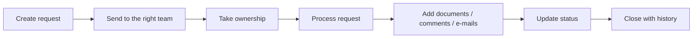

### Before / after

| Before | With the application |
|---|---|
| Request sent by e-mail | Guided request creation |
| Hard to know who owns it | Team and assignee are visible |
| Documents stored separately | Documents linked to the ticket |
| E-mail discussion outside the tool | Conversation archived with the ticket |
| Manual relaunches | Status and history visible |

### Main screens

#### Requester

[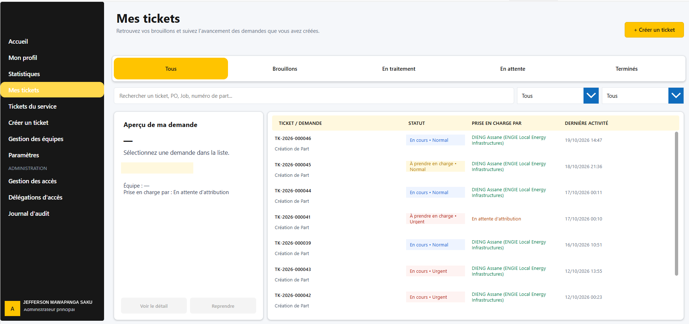](./assets/04-my-tickets_4K.png)

[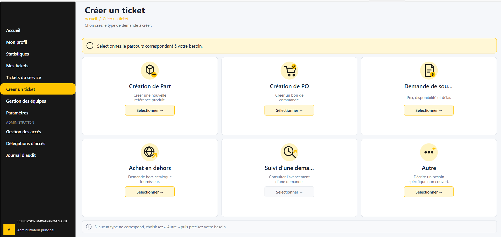](./assets/06-create-ticket_4K.png)

#### Operational team

[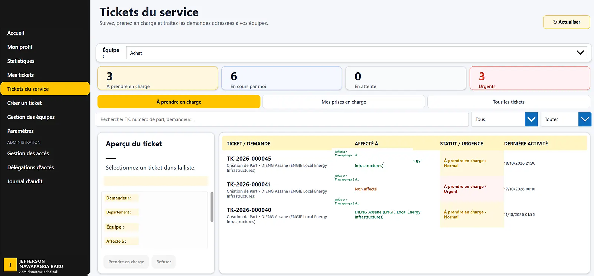](./assets/05-service-tickets_4K.png)

[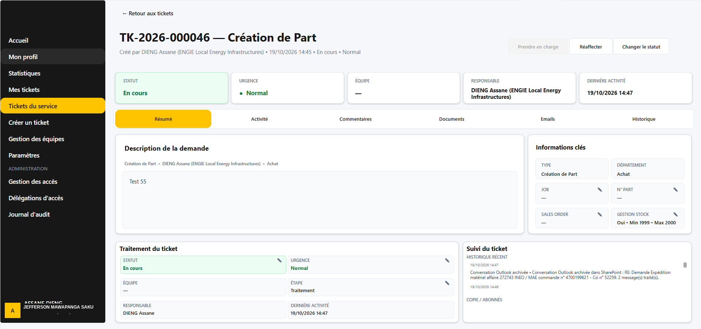](./assets/12-ticket-detail_4K.png)

[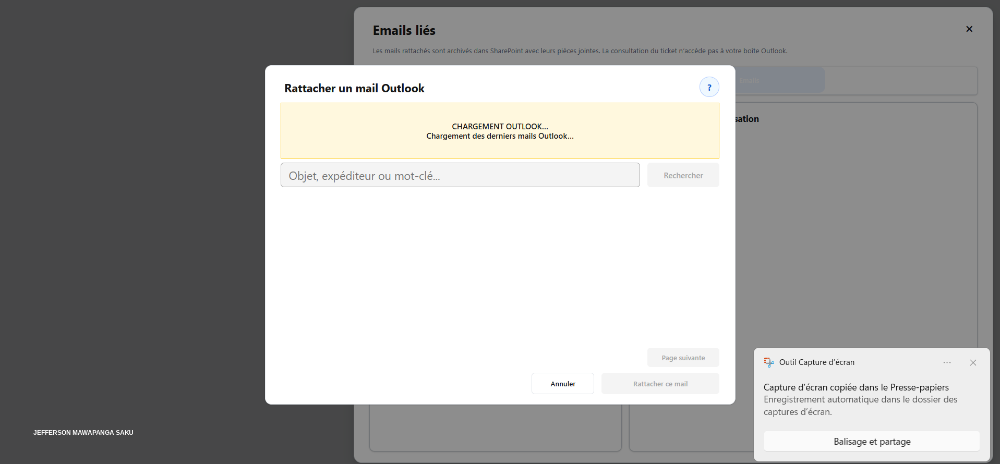](./assets/13-outlook-archive_4K.png)

#### Administration

[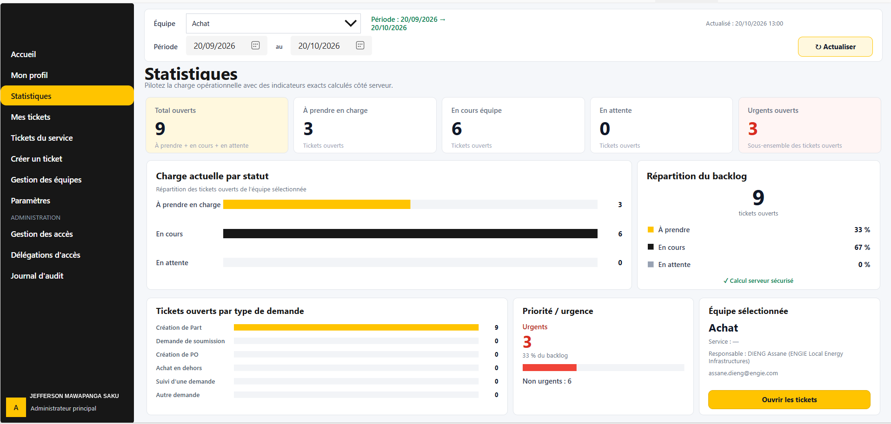](./assets/03-statistics_4K.png)

[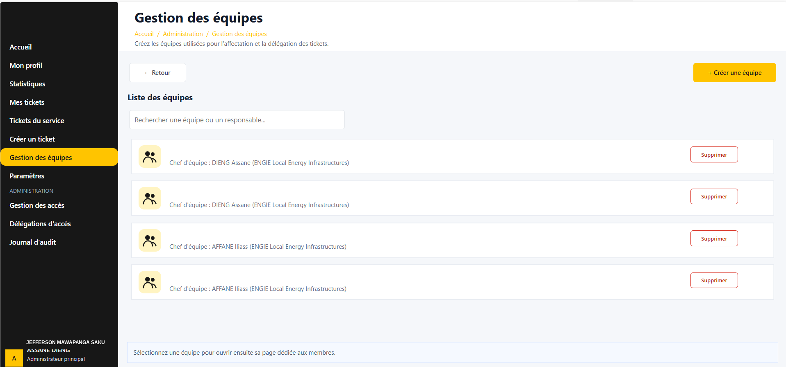](./assets/07-team-management_4K.png)

[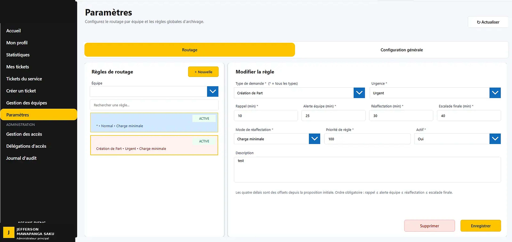](./assets/08-settings_4K.png)

[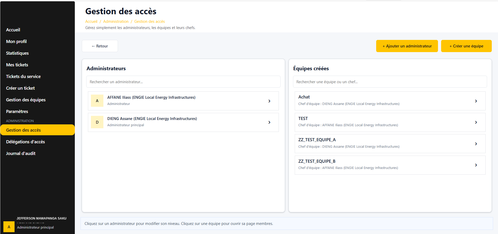](./assets/09-access-management_4K.png)

[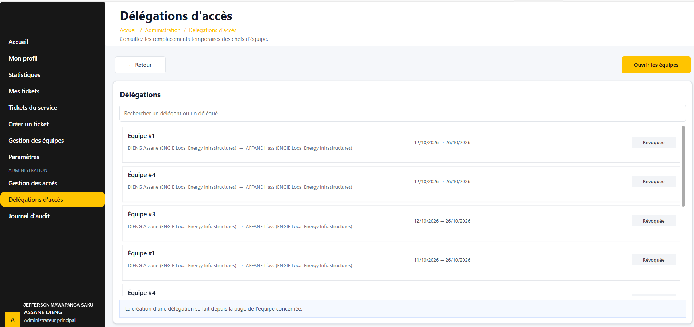](./assets/10-delegations_4K.png)

[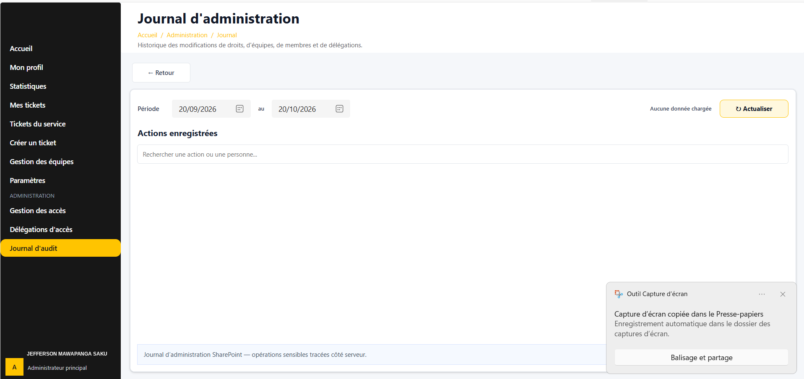](./assets/11-admin-journal_4K.png)

### Want the technical detail?

- **[Architecture →](./docs/ARCHITECTURE.md)**
- **[User journey →](./docs/USER_JOURNEY.md)**
- **[Automation catalogue →](./docs/FLOW_CATALOG.md)**
- **[Security & governance →](./docs/SECURITY_GOVERNANCE.md)**

---

## 🇫🇷 Français

### Comprendre le projet en 30 secondes

**Problème :** une demande métier peut se perdre entre les e-mails, les documents, les relances et plusieurs équipes.

**Solution :** une seule application qui regroupe la demande, son responsable, son statut, ses documents, commentaires, conversations Outlook et son historique.

**Résultat :** le demandeur sait où en est sa demande et l’équipe opérationnelle sait ce qu’elle doit traiter.

### Fonctionnement

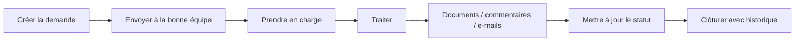

### Avant / après

| Avant | Avec l’application |
|---|---|
| Demande par e-mail | Création guidée |
| Responsable difficile à identifier | Équipe et responsable visibles |
| Documents séparés | Documents liés au ticket |
| Conversation e-mail à part | Conversation archivée dans le ticket |
| Relances manuelles | Statut et historique visibles |

### Écrans principaux

Les images ci-dessus correspondent aux mêmes parcours : **demandeur → équipe → administration**. Chaque image est cliquable pour l’ouvrir en grand.

### Pour aller plus loin techniquement

- **[Architecture →](./docs/ARCHITECTURE.md)**
- **[Parcours utilisateur →](./docs/USER_JOURNEY.md)**
- **[Catalogue des automatisations →](./docs/FLOW_CATALOG.md)**
- **[Sécurité & gouvernance →](./docs/SECURITY_GOVERNANCE.md)**
