# Ticketing & Request Management

[← Portfolio](../../README.md) · [▶ Démo / Demo](https://www.youtube.com/watch?v=_jR8T9s2VUE)

> 🇫🇷 **Une application métier pour éviter qu’une demande se perde entre les e-mails, les documents, les relances et plusieurs équipes.**  
> *🇬🇧 A business application designed to prevent requests from getting lost between e-mails, documents, follow-ups and multiple teams.*

## ⚡ Comprendre en 30 secondes / Understand in 30 seconds

**🇫🇷 Problème :** les demandes sont dispersées et il devient difficile de savoir qui traite quoi, où sont les documents et quel est le statut réel.  
*🇬🇧 Problem: requests are scattered, making it hard to know who owns what, where documents are and what the real status is.*

**🇫🇷 Solution :** une seule application pour créer, router, affecter, traiter et clôturer la demande tout en conservant documents, commentaires, e-mails et historique.  
*🇬🇧 Solution: one application to create, route, assign, process and close the request while keeping documents, comments, e-mails and history together.*

**🇫🇷 Résultat :** le demandeur voit où en est sa demande et l’équipe opérationnelle voit immédiatement ce qu’elle doit traiter.  
*🇬🇧 Result: the requester can see request progress and the operational team can immediately see what needs attention.*

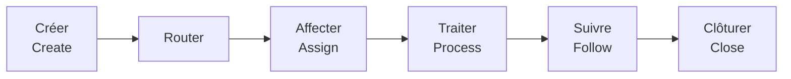

## 🎬 Démonstration / Demo

**[▶ Voir la vidéo complète / Watch the full demo →](https://www.youtube.com/watch?v=_jR8T9s2VUE)**

---

# Parcours complet image par image / Full image-by-image walkthrough

## 1. Accueil / Home dashboard

🇫🇷 L’accueil sert de point d’entrée. L’utilisateur retrouve ses demandes récentes, les raccourcis vers ses tickets, les tickets du service et les actions importantes sans devoir connaître la structure technique derrière l’application.  
*🇬🇧 The home page is the entry point. Users see recent requests, shortcuts to personal tickets, service tickets and important actions without needing to understand the technical structure behind the app.*

## 2. Profil, absences et délégation / Profile, absence & delegation

<a href="./assets/02-profile_4K.png">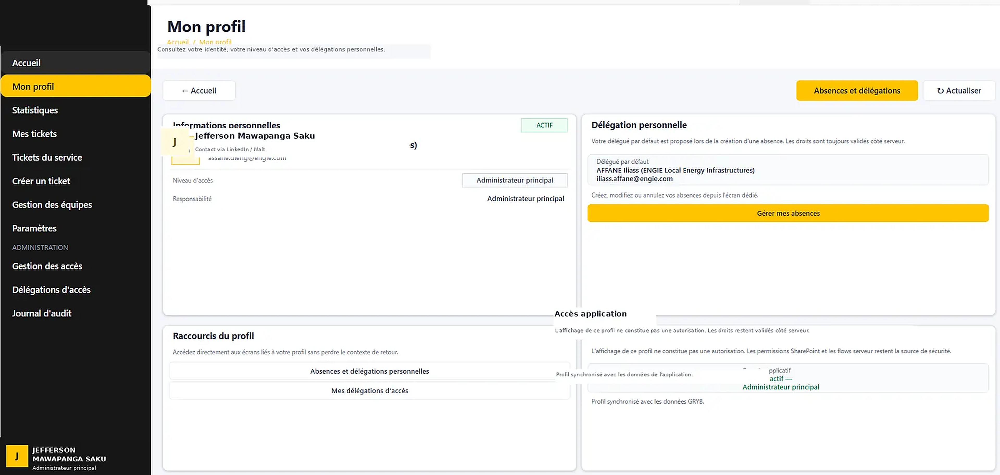</a>

🇫🇷 Le profil regroupe le contexte de l’utilisateur et les informations d’absence/délégation. Le but est d’éviter qu’une absence bloque le traitement : la délégation peut être gérée comme une donnée métier temporaire plutôt que comme un changement permanent de rôle.  
*🇬🇧 The profile brings together the user context and absence/delegation information. The goal is to prevent an absence from blocking work: delegation can be managed as temporary business data rather than a permanent role change.*

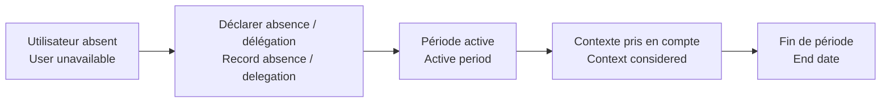

🇫🇷 Le flow documenté **PA_ProfilAbsencesDelegations_V1** prend en charge la gestion profil/absence/délégation côté automatisation. Les règles précises de droits de production ne sont pas publiées.  
*🇬🇧 The documented **PA_ProfilAbsencesDelegations_V1** flow handles profile/absence/delegation management on the automation side. Exact production permission rules are not published.*
## 3. Statistiques opérationnelles / Operational statistics

🇫🇷 Cette vue transforme la file de tickets en indicateurs lisibles : charge ouverte, tickets non pris en charge, en cours, en attente, urgents ou en backlog. Le responsable peut comprendre la situation sans ouvrir chaque demande.  
*🇬🇧 This view turns the ticket queue into readable indicators: open workload, unowned tickets, in-progress, waiting, urgent and backlog items. A manager can understand the situation without opening every request.*

## 4. Mes tickets / My tickets

🇫🇷 L’espace personnel sépare les brouillons des tickets réellement envoyés. Un brouillon reste un travail en cours : il ne doit pas polluer la file opérationnelle tant que l’utilisateur n’a pas confirmé la soumission finale.  
*🇬🇧 The personal workspace separates drafts from submitted tickets. A draft remains work in progress: it should not pollute the operational queue until the user confirms final submission.*

🇫🇷 Les valeurs par défaut seules ne doivent pas être considérées comme une modification métier.  
*🇬🇧 Default values alone should not be treated as meaningful business changes.*
## 5. Tickets du service / Service tickets

🇫🇷 Cette page est la file de travail des équipes. Elle permet de voir les demandes arrivées dans le service, d’identifier les urgences, de prendre en charge un ticket, de le réaffecter et de suivre son état.  
*🇬🇧 This page is the operational team queue. It shows requests arriving in the service, highlights urgency, allows ownership, reassignment and status follow-up.*

## 6. Création d’une demande / Request creation

🇫🇷 La création guide l’utilisateur au lieu de lui demander de connaître les règles internes. Le formulaire s’adapte au type de demande et collecte uniquement les informations utiles avant la vérification finale.  
*🇬🇧 Creation guides the user instead of requiring knowledge of internal rules. The form adapts to the request type and collects only the useful information before final review.*

🇫🇷 Les parcours documentés couvrent : **Création de Part, Création de PO, Demande de soumission, Achat hors catalogue, Suivi d’une demande et Autre demande**.  
*🇬🇧 Documented journeys cover **Part creation, PO creation, quotation/submission request, off-catalogue purchase, request follow-up and other request**.*

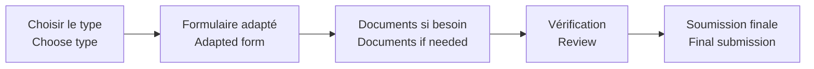
## 7. Gestion des équipes / Team management

🇫🇷 Cette vue centralise les équipes et leur organisation. Elle sert à structurer qui traite quoi et à éviter que les règles d’affectation restent uniquement dans la tête des utilisateurs.  
*🇬🇧 This view centralises teams and their organisation. It structures who handles what and avoids keeping assignment rules only in users’ heads.*

## 8. Paramètres et routage / Settings & routing

🇫🇷 Les paramètres permettent de piloter le comportement du système sans modifier l’interface pour chaque règle. Le routage sert à envoyer les demandes vers le bon périmètre et à préparer rappels, réaffectations ou escalades.  
*🇬🇧 Settings let the system behaviour be managed without changing the interface for every rule. Routing sends requests to the correct scope and supports reminders, reassignment or escalation.*

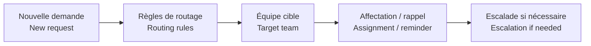
## 9. Gestion des accès / Access management

🇫🇷 La gestion des accès sépare l’expérience utilisateur de la sécurité réelle. Masquer un bouton améliore l’interface, mais les actions sensibles doivent aussi être contrôlées au niveau des données ou des flows.  
*🇬🇧 Access management separates user experience from real security. Hiding a button improves the interface, but sensitive actions must also be controlled at the data or flow layer.*

## 10. Délégations / Delegations

🇫🇷 Cette page donne une vue administrative des délégations temporaires. Le principe est de conserver une période, un contexte et une trace afin qu’un remplacement soit contrôlé et réversible.  
*🇬🇧 This page gives an administrative view of temporary delegations. The principle is to keep a period, context and trace so replacement access is controlled and reversible.*

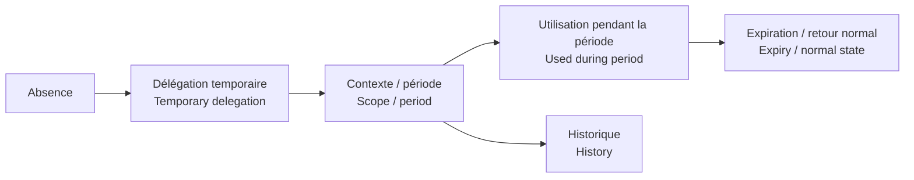
## 11. Journal d’administration / Administration journal

🇫🇷 Le journal sert à garder une trace des actions d’administration et des changements importants. Cette traçabilité permet de comprendre qui a modifié quoi et de diagnostiquer plus facilement les incohérences.  
*🇬🇧 The administration journal keeps a trace of administrative actions and important changes. This traceability helps explain who changed what and makes inconsistencies easier to diagnose.*

## 12. Détail d’un ticket / Ticket detail

🇫🇷 Le ticket devient le point de référence unique : statut, urgence, équipe, responsable, activité, commentaires, documents, e-mails liés et historique sont regroupés au même endroit.  
*🇬🇧 The ticket becomes the single reference point: status, urgency, team, owner, activity, comments, documents, linked e-mails and history are kept together.*

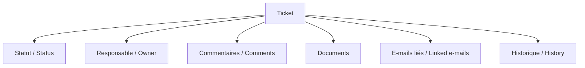
## 13. Archivage Outlook / Outlook conversation archiving

🇫🇷 L’utilisateur peut rattacher une conversation Outlook au ticket. Les messages et pièces jointes sont archivés afin que le contexte métier reste consultable depuis le ticket sans dépendre uniquement de la boîte mail d’origine.  
*🇬🇧 The user can attach an Outlook conversation to the ticket. Messages and attachments are archived so business context remains readable from the ticket without relying only on the original mailbox.*

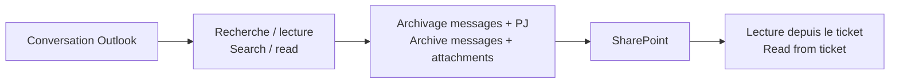

---

# 🔄 Cycle complet d’une demande / Full request lifecycle

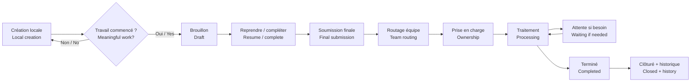

🇫🇷 Un document peut être ajouté pendant la préparation sans transformer automatiquement le brouillon en ticket soumis.  
*🇬🇧 A document can be added during preparation without automatically turning the draft into a submitted ticket.*

# 🧩 Architecture technique globale / Overall technical architecture

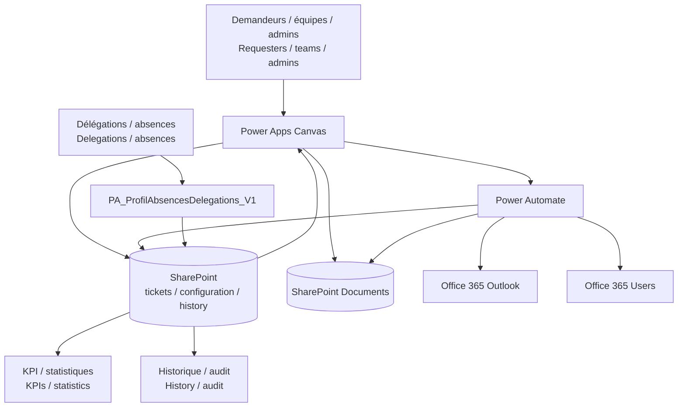

**🇫🇷 Power Apps** gère l’expérience utilisateur, la navigation, les formulaires et les interactions.  
*🇬🇧 Power Apps manages the user experience, navigation, forms and interactions.*

**🇫🇷 SharePoint** stocke les tickets, documents, paramètres, historiques et données d’accès nécessaires au fonctionnement.  
*🇬🇧 SharePoint stores tickets, documents, settings, history and access-related business data.*

**🇫🇷 Power Automate** gère les traitements contrôlés : routage, actions ticket, documents, notifications, Outlook, délégations et traitements programmés.  
*🇬🇧 Power Automate handles controlled processing: routing, ticket actions, documents, notifications, Outlook, delegations and scheduled work.*

**🇫🇷 Outlook / Office 365 Users** fournissent l’intégration messagerie et la résolution des utilisateurs.  
*🇬🇧 Outlook / Office 365 Users provide e-mail integration and user resolution.*

# ⚙️ Paysage des automatisations / Automation landscape

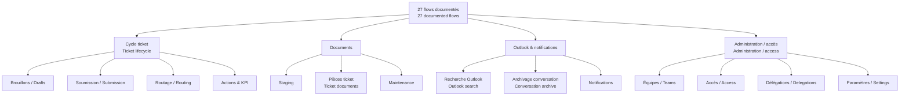

# 🛡️ Sécurité, fiabilité et performance / Security, reliability & performance

🇫🇷 L’interface n’est pas considérée comme la frontière de sécurité : une action sensible doit être revalidée côté donnée ou flow.  
*🇬🇧 The interface is not treated as the security boundary: sensitive actions should be revalidated at the data or flow layer.*

🇫🇷 La conception documente aussi la réduction des Refresh inutiles, le filtrage côté source, la limitation des appels séquentiels, la gestion explicite des erreurs, les contrôles anti-doublons/idempotence et la traçabilité.  
*🇬🇧 The design also documents reduced unnecessary Refresh calls, source-side filtering, fewer sequential network calls, explicit error handling, duplicate/idempotency controls and traceability.*

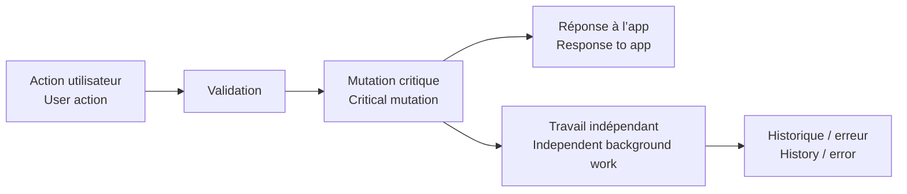

# 📦 Échelle documentée / Documented scale

- **28** écrans Canvas / Canvas screen definitions
- **27** flows Power Automate / Power Automate flows
- **29** variables d’environnement / environment-variable definitions
- Connecteurs documentés : **SharePoint, Office 365 Outlook, Office 365 Users**

# 🔎 Détails techniques / Technical deep dive

- [Architecture détaillée / Detailed architecture](./docs/ARCHITECTURE.md)
- [Parcours utilisateur / User journey](./docs/USER_JOURNEY.md)
- [Catalogue des flows / Flow catalogue](./docs/FLOW_CATALOG.md)
- [Sécurité & gouvernance / Security & governance](./docs/SECURITY_GOVERNANCE.md)
- [Notes de démonstration / Demo notes](./demo/README.md)

---

🇫🇷 Cette version publique est anonymisée : les packages de production, URL tenant, secrets, données confidentielles et exports sources complets ne sont pas publiés.  
*🇬🇧 This public version is sanitised: production packages, tenant URLs, secrets, confidential data and full source exports are not published.*
