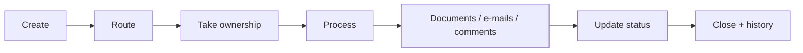
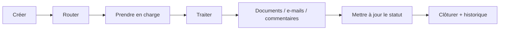

# Ticketing & Request Management

[← Portfolio](../../README.md) · [▶ Demo](https://www.youtube.com/watch?v=_jR8T9s2VUE)

---

## 🇬🇧 English

### Understand the project in 30 seconds

**Problem:** a business request can be lost between e-mails, documents, follow-ups and several teams.

**Solution:** one application that keeps the request, owner, status, documents, comments, linked Outlook conversations and history together.

**Result:** the requester can follow the request and the operational team can immediately see what needs to be processed.

### Before / after

| Before | With the application |
|---|---|
| Request by e-mail | Guided request creation |
| Ownership unclear | Team and assignee visible |
| Documents separate | Documents linked to the ticket |
| E-mails outside the process | Outlook conversation archived |
| Manual follow-up | Status and history visible |

### Visual gallery — click to enlarge

<table>
<tr>
<td width="33%"> <b>Home</b></td>
<td width="33%"> <b>Profile</b></td>
<td width="33%"> <b>Statistics</b></td>
</tr>
<tr>
<td> <b>My tickets</b></td>
<td> <b>Service tickets</b></td>
<td> <b>Create request</b></td>
</tr>
<tr>
<td> <b>Teams</b></td>
<td> <b>Settings</b></td>
<td> <b>Access</b></td>
</tr>
<tr>
<td> <b>Delegations</b></td>
<td> <b>Audit</b></td>
<td> <b>Ticket detail</b></td>
</tr>
<tr>
<td> <b>Outlook archive</b></td>
<td></td><td></td>
</tr>
</table>

### Technical detail

- **[Architecture →](./docs/ARCHITECTURE.md)**
- **[User journey →](./docs/USER_JOURNEY.md)**
- **[Automation catalogue →](./docs/FLOW_CATALOG.md)**
- **[Security & governance →](./docs/SECURITY_GOVERNANCE.md)**

---

## 🇫🇷 Français

### Comprendre le projet en 30 secondes

**Problème :** une demande métier peut se perdre entre les e-mails, les documents, les relances et plusieurs équipes.

**Solution :** une seule application qui regroupe la demande, le responsable, le statut, les documents, commentaires, conversations Outlook et l’historique.

**Résultat :** le demandeur sait où en est sa demande et l’équipe sait immédiatement ce qu’elle doit traiter.

### Avant / après

| Avant | Avec l’application |
|---|---|
| Demande par e-mail | Création guidée |
| Responsable peu clair | Équipe et responsable visibles |
| Documents séparés | Documents liés au ticket |
| E-mails hors processus | Conversation Outlook archivée |
| Relances manuelles | Statut et historique visibles |

### Galerie

Les **13 captures ci-dessus** sont cliquables pour être ouvertes en grand.

### Détail technique

- **[Architecture →](./docs/ARCHITECTURE.md)**
- **[Parcours utilisateur →](./docs/USER_JOURNEY.md)**
- **[Catalogue des automatisations →](./docs/FLOW_CATALOG.md)**
- **[Sécurité & gouvernance →](./docs/SECURITY_GOVERNANCE.md)**
