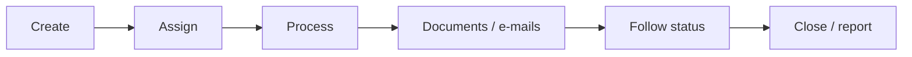
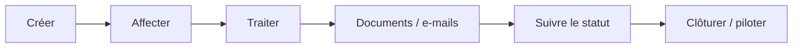

# Ticketing Demo

[← Project](../README.md)

---

## 🇬🇧 English

**[▶ Watch the full demo](https://www.youtube.com/watch?v=_jR8T9s2VUE)**

The video shows the user journey first. Technical implementation details are documented separately.

---

## 🇫🇷 Français

**[▶ Voir la démonstration complète](https://www.youtube.com/watch?v=_jR8T9s2VUE)**

La vidéo montre d’abord le parcours utilisateur. Les détails techniques sont documentés séparément.
