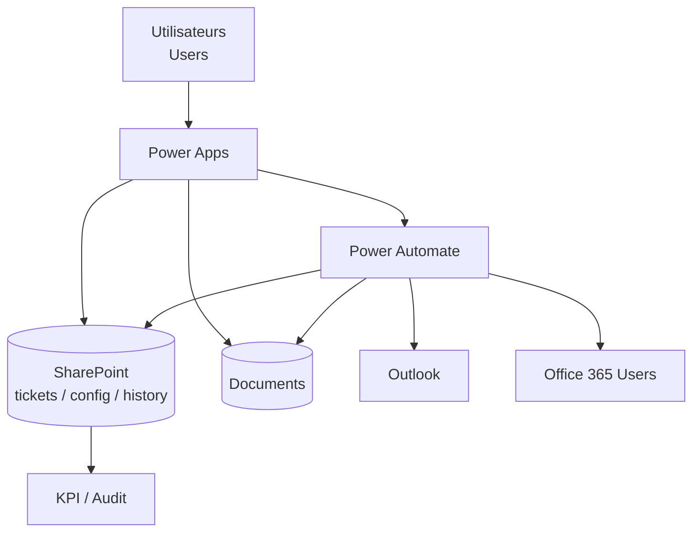
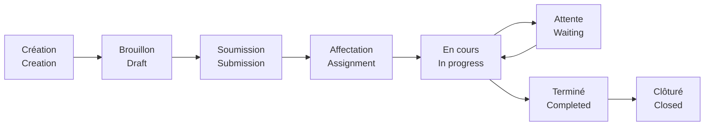
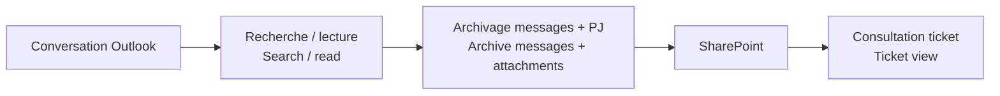

# Architecture — Ticketing

[← Projet / Project](../README.md)

## 🧩 Vue simple / Simple view

🇫🇷 **Power Apps** porte l’interface, les formulaires, la navigation et le contexte utilisateur.  
*🇬🇧 **Power Apps** provides the interface, forms, navigation and user context.*

🇫🇷 **SharePoint** stocke les tickets, documents, paramètres, historiques et données nécessaires au pilotage.  
*🇬🇧 **SharePoint** stores tickets, documents, settings, history and data needed for operations.*

🇫🇷 **Power Automate** exécute les actions contrôlées : routage, documents, notifications, Outlook, délégations et traitements programmés.  
*🇬🇧 **Power Automate** executes controlled actions: routing, documents, notifications, Outlook, delegations and scheduled processing.*

## 🔄 Cycle de vie / Lifecycle

🇫🇷 Un document ajouté pendant la préparation ne soumet pas automatiquement le ticket.  
*🇬🇧 Adding a document during preparation does not automatically submit the ticket.*

## ✉️ Archivage Outlook / Outlook archive

## ⚡ Performance / Performance

🇫🇷 Principes documentés : filtrage côté source, réduction des Refresh inutiles, limitation des appels réseau séquentiels, parallélisme uniquement pour des tâches indépendantes.  
*🇬🇧 Documented principles: source-side filtering, fewer unnecessary Refresh calls, reduced sequential network calls, and parallelism only for independent work.*

## 📦 Échelle / Scale

- 🇫🇷 28 écrans Canvas.  
  *🇬🇧 28 Canvas screen definitions.*
- 🇫🇷 27 flows Power Automate.  
  *🇬🇧 27 Power Automate flows.*
- 🇫🇷 29 variables d’environnement.  
  *🇬🇧 29 environment-variable definitions.*
