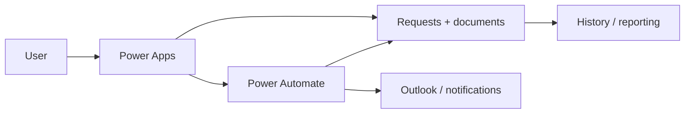
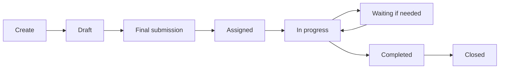
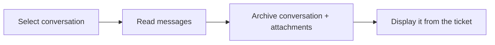
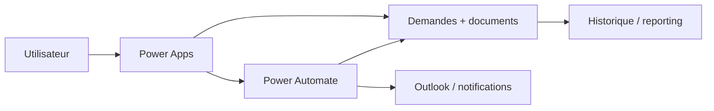
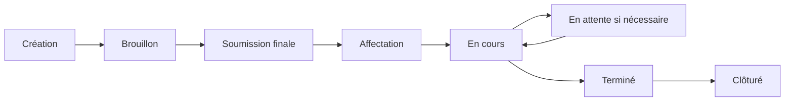

# Architecture — Ticketing & Request Management

[← Project](../README.md)

---

## 🇬🇧 English

### Simple explanation

The user sees one application, but several services work behind it.

### What each part does

- **Power Apps:** the screens and forms used by the user.
- **SharePoint:** stores requests, documents and configuration.
- **Power Automate:** performs controlled actions and repetitive tasks.
- **Outlook / Microsoft 365:** handles e-mail and user information.

### Request lifecycle

A document upload does **not** submit a ticket. Submission happens only when the user confirms the final step.

### Outlook conversation

### Technical facts

The documented solution contains **28 Canvas screens**, **27 Power Automate flows** and **29 environment-variable definitions**.

---

## 🇫🇷 Français

### Explication simple

L’utilisateur voit une seule application, mais plusieurs services travaillent derrière.

### Rôle de chaque élément

- **Power Apps :** les écrans et formulaires utilisés par l’utilisateur.
- **SharePoint :** stocke les demandes, documents et paramètres.
- **Power Automate :** réalise les actions contrôlées et répétitives.
- **Outlook / Microsoft 365 :** gère les e-mails et informations utilisateurs.

### Cycle de vie

Ajouter un document ne soumet **pas** automatiquement le ticket. La soumission existe uniquement après confirmation finale.
