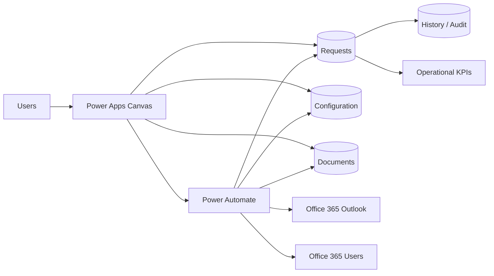
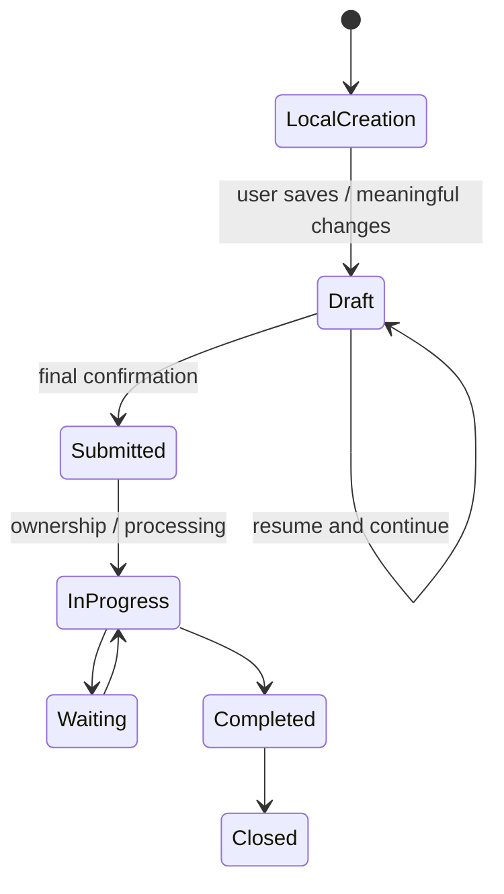
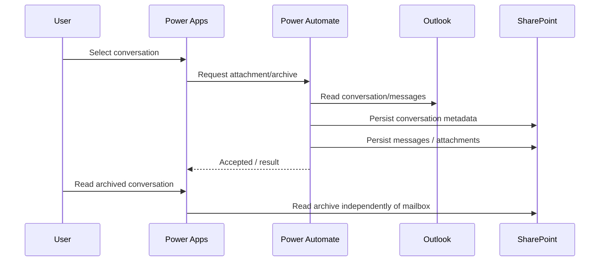

# Architecture — Power Platform Ticketing & Request Management

[← Case study](../README.md)

## Overview

## Canvas application

The supplied Canvas package contains **28 screen definitions** plus reusable components.

Main functional areas:

- home dashboard;
- personal profile and absences;
- statistics;
- personal tickets and drafts;
- service ticket queues;
- request creation journeys;
- document management;
- ticket detail;
- team management;
- routing/settings;
- access administration;
- delegations;
- administration journal.

The left navigation is shared across standard screens to maintain a consistent application shell.

## Power Automate solution

The supplied automation package contains:

- **27 cloud flows**
- **29 environment-variable definitions**
- connection references for:
  - SharePoint
  - Office 365 Outlook
  - Office 365 Users

Environment variables separate environment-specific configuration such as SharePoint locations, list identifiers and application configuration from the flow logic.

## Data responsibilities

The public portfolio does not publish tenant-specific list GUIDs or URLs.

Conceptually, SharePoint stores:

- requests/tickets;
- teams and membership;
- access and delegations;
- documents and staging records;
- comments and follow-up;
- Outlook conversation/message archive;
- routing/notification configuration;
- operational history and administration audit.

## Request lifecycle

A document upload does **not** define the business transition from draft to submitted ticket. The transition occurs only through the final submission path.

## Outlook archive

## Performance principles

- filter at the data source where supported;
- avoid loading whole SharePoint lists to work around delegation;
- reduce repeated refreshes and N+1 network calls;
- use bounded parallelism only for independent operations;
- return to Power Apps early only after required validation and critical mutation are safely accepted;
- keep background document/e-mail work observable through history and error states.

## Licensing boundary

The exported connector set documented in the supplied solution contains SharePoint, Office 365 Outlook and Office 365 Users. Licensing and connector classification must still be validated in the target Microsoft 365 / Power Platform tenant before production deployment.
