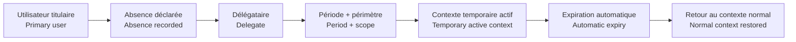
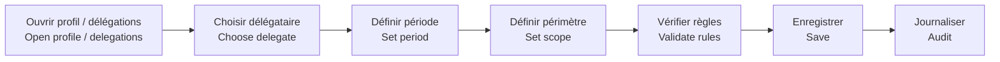
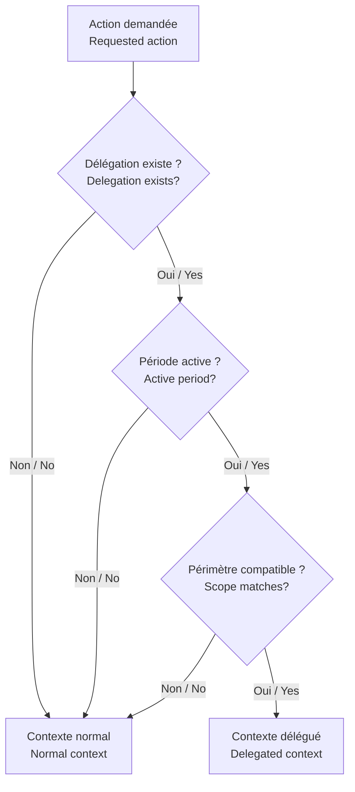
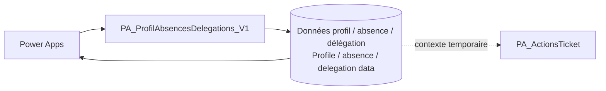
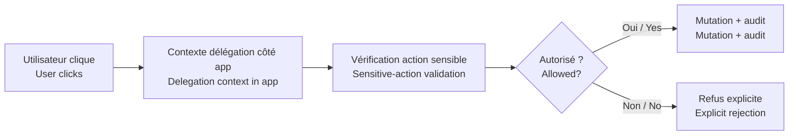
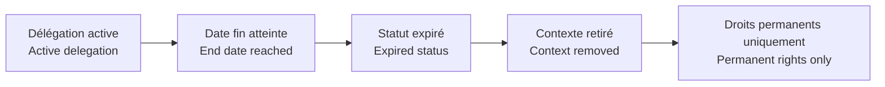
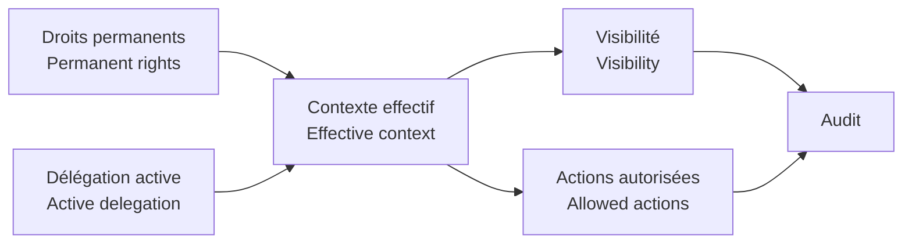

# Système d’absence & délégation / Absence & Delegation System

[← Projet Ticketing](../README.md) · [Architecture](./ARCHITECTURE.md) · [Sécurité](./SECURITY_GOVERNANCE.md) · [Catalogue des flows](./FLOW_CATALOG.md)

> 🇫🇷 Cette page documente le fonctionnement complet du système de délégation temporaire : création, période, contexte, activation, utilisation, expiration, audit et cas d’erreur.  
> *🇬🇧 This page documents the complete temporary-delegation system: creation, period, scope, activation, use, expiry, audit and failure cases.*

## 1. Pourquoi une délégation ? / Why delegation exists

🇫🇷 Une absence ne doit pas bloquer un ticket, mais elle ne doit pas non plus modifier définitivement les rôles ou droits d’un utilisateur. La délégation est donc traitée comme **un contexte temporaire et traçable**.  
*🇬🇧 An absence should not block ticket processing, but it should not permanently change user roles or permissions either. Delegation is therefore treated as **temporary, traceable context**.*

## 2. Les objets fonctionnels / Functional objects

| Élément | Français | English |
|---|---|---|
| **Titulaire** | personne normalement responsable ou autorisée | person normally responsible or authorised |
| **Délégataire** | personne qui agit temporairement dans le périmètre autorisé | person temporarily acting in the authorised scope |
| **Date début** | début de validité | validity start |
| **Date fin** | fin de validité | validity end |
| **Périmètre** | contexte auquel la délégation s’applique | scope where the delegation applies |
| **Statut** | planifiée, active, expirée, annulée | planned, active, expired, cancelled |
| **Trace** | qui a créé/modifié/annulé la délégation | who created/changed/cancelled the delegation |

## 3. Création d’une délégation / Creating a delegation

### Contrôles fonctionnels / Functional checks

- 🇫🇷 le titulaire et le délégataire doivent être identifiables dans Microsoft 365 ;  
  *🇬🇧 primary user and delegate must be resolvable in Microsoft 365;*
- 🇫🇷 la date de fin doit être postérieure ou égale à la date de début ;  
  *🇬🇧 end date must be on or after start date;*
- 🇫🇷 une délégation expirée ne doit pas rester active ;  
  *🇬🇧 an expired delegation must not remain active;*
- 🇫🇷 une délégation ne doit pas transformer un rôle temporaire en droit permanent ;  
  *🇬🇧 delegation must not turn temporary context into permanent permissions;*
- 🇫🇷 une annulation doit laisser une trace au lieu de supprimer silencieusement l’historique.  
  *🇬🇧 cancellation should leave an audit trail instead of silently deleting history.*

## 4. Activation / Activation

🇫🇷 La délégation devient active uniquement lorsque **la date courante est comprise dans la période**, que son statut autorise l’utilisation et que le périmètre correspond à l’action demandée.  
*🇬🇧 Delegation becomes active only when **the current date falls within the validity period**, the status allows use and the scope matches the requested action.*

## 5. Comment l’application l’utilise / How the app uses it

🇫🇷 Power Apps récupère le contexte utilisateur et les délégations pertinentes au chargement des vues ou avant une action sensible. Le but est d’adapter **visibilité, périmètre et actions disponibles**, pas de copier définitivement les droits du titulaire.  
*🇬🇧 Power Apps resolves user context and relevant delegations when loading views or before a sensitive action. The goal is to adapt **visibility, scope and available actions**, not permanently copy the primary user’s permissions.*

### Exemples / Examples

- 🇫🇷 voir temporairement les tickets d’un périmètre délégué ;  
  *🇬🇧 temporarily view tickets in a delegated scope;*
- 🇫🇷 prendre en charge ou réaffecter dans le périmètre autorisé ;  
  *🇬🇧 take ownership or reassign within the authorised scope;*
- 🇫🇷 conserver l’identité réelle de la personne qui agit dans l’historique ;  
  *🇬🇧 keep the real acting user identity in history;*
- 🇫🇷 indiquer que l’action a été faite sous délégation lorsqu’elle est auditée.  
  *🇬🇧 indicate that an action was performed under delegation when audited.*

## 6. PA_ProfilAbsencesDelegations_V1

🇫🇷 Le flow documenté **PA_ProfilAbsencesDelegations_V1** constitue la couche d’automatisation du sous-système profil/absence/délégation.  
*🇬🇧 The documented **PA_ProfilAbsencesDelegations_V1** flow is the automation layer for profile/absence/delegation management.*

### Responsabilités documentées / Documented responsibilities

1. 🇫🇷 lire le contexte profil ;  
   *🇬🇧 read profile context;*
2. 🇫🇷 créer ou mettre à jour une absence/délégation ;  
   *🇬🇧 create or update absence/delegation;*
3. 🇫🇷 retourner les délégations utiles à l’application ;  
   *🇬🇧 return relevant delegations to the app;*
4. 🇫🇷 conserver un état cohérent entre période, statut et utilisateur ;  
   *🇬🇧 keep period, status and user state consistent.*

## 7. Délégation et sécurité / Delegation and security

> 🇫🇷 **Une délégation affichée dans Power Apps n’est pas suffisante pour sécuriser une action.**  
> *🇬🇧 A delegation displayed in Power Apps is not enough to secure an action.*

🇫🇷 Lorsqu’une action modifie une donnée critique, le contexte doit être vérifié côté donnée/flow selon les règles du projet.  
*🇬🇧 When an action changes critical data, context should be validated at the data/flow layer according to project rules.*

## 8. Priorité des droits / Permission precedence

🇫🇷 La logique fonctionnelle recommandée est : **droits permanents d’abord, délégation temporaire ensuite comme extension limitée**, jamais l’inverse.  
*🇬🇧 The recommended functional logic is: **permanent permissions first, temporary delegation as a limited extension**, never the reverse.*

1. identité réelle / real identity  
2. rôle permanent / permanent role  
3. équipe(s) permanente(s) / permanent team(s)  
4. délégation active et compatible / active compatible delegation  
5. action autorisée dans le périmètre effectif / action allowed in effective scope  

## 9. Expiration / Expiry

🇫🇷 Aucun nettoyage manuel ne devrait être nécessaire pour continuer à travailler après la date de fin.  
*🇬🇧 No manual cleanup should be required for normal work to continue after the end date.*

## 10. Journalisation / Audit

🇫🇷 Le journal doit permettre de comprendre :  
*🇬🇧 The audit trail should make it possible to understand:*

- qui a créé la délégation / who created it;
- qui est titulaire et délégataire / primary user and delegate;
- période de validité / validity period;
- périmètre / scope;
- modification ou annulation / change or cancellation;
- identité réelle de la personne ayant exécuté une action / real identity of the person performing an action.

## 11. Cas limites / Edge cases

### Délégation expirée / Expired delegation
🇫🇷 ignorée automatiquement.  
*🇬🇧 automatically ignored.*

### Délégation annulée / Cancelled delegation
🇫🇷 ne donne plus de contexte mais reste traçable.  
*🇬🇧 no longer grants context but remains auditable.*

### Utilisateur absent sans délégataire / Absent user without delegate
🇫🇷 le processus doit permettre une réaffectation administrative selon les droits existants.  
*🇬🇧 the process should still allow administrative reassignment according to existing permissions.*

### Délégations qui se chevauchent / Overlapping delegations
🇫🇷 elles doivent être évaluées par périmètre et période, sans fusionner automatiquement tous les droits.  
*🇬🇧 they should be evaluated by scope and period without automatically merging all permissions.*

### Délégataire supprimé ou introuvable / Delegate removed or unresolved
🇫🇷 la délégation doit être considérée comme non exploitable et signalée.  
*🇬🇧 the delegation should be treated as unusable and flagged.*

## 12. Dépendances / Dependencies

| Composant | Relation avec délégation / Relationship to delegation |
|---|---|
| Power Apps | affiche et utilise le contexte temporaire |
| PA_ProfilAbsencesDelegations_V1 | gère profil, absence et délégation |
| PA_ActionsTicket | consomme le contexte effectif pour les actions métier |
| PA_AdministrationAccesEquipes_V1 | fournit les droits permanents équipe |
| Journal d’administration | conserve les changements |
| Tickets du service | adapte le périmètre visible selon le contexte effectif |

## 13. Résumé / Summary

🇫🇷 Le système de délégation ne remplace pas les rôles : il ajoute temporairement un contexte contrôlé et réversible.  
*🇬🇧 The delegation system does not replace roles: it temporarily adds controlled, reversible context.*
