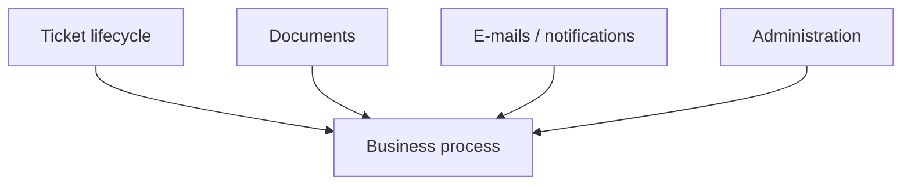

# Automation Catalogue — Ticketing

[← Project](../README.md)

---

## 🇬🇧 English

### What the automations do

There are **27 documented Power Automate flows**, but they can be understood as four business groups.

#### 1. Ticket lifecycle

Draft → submission → routing → assignment → status → closure.

#### 2. Documents

Prepare documents, list them, delete them, attach them to the final ticket and maintain them later.

#### 3. Outlook & notifications

Search messages, archive a conversation, synchronise it and notify the right users.

#### 4. Administration

Manage teams, access, routing rules, parameters, delegations, favourites and retention.

<strong>Technical flow names</strong>

Ticket lifecycle: PA_BrouillonsTicket_V1, PA_ActionsTicket, PA_InitialiserTransmissionTicket, PA_MoteurRoutageTickets, PA_KPITicketsService_V1.

Documents: PA_DocumentStaging_V1, PA_DocumentsListerStaging_V1, PA_DocumentsSupprimerPieceStaging_V1, PA_DocumentsTicket_V2, PA_MaintenanceDocuments.

Outlook / notifications: PA_Outlook_RechercherMessages_V1, PA_RattacherConversationOutlook, PA_SynchroniserConversationsOutlook, PA_Mail_DetecterNouveauxDocuments, PA_Mail_GererAffectation, PA_Mail_EnvoyerNotifications, PA_Mail_CreerNotificationsHistorique, PA_Mail_NotifierAjoutCopie, PA_AjouterCopiesTicket_V2.

Administration: PA_AdministrationParametres_V1, PA_AdministrationAccesEquipes_V1, PA_AdministrationNotifications_V1, PA_AdministrationReglesRoutage_V1, PA_ProfilAbsencesDelegations_V1, PA_FavorisNavigateurSharePoint_V1, PA_Graph_NavigateurSharePoint_V2, PA_ArchivageRetentionTickets.

---

## 🇫🇷 Français

### À quoi servent les automatisations

Les **27 flows Power Automate** se comprennent plus simplement en quatre groupes métier.

#### 1. Cycle du ticket

Brouillon → soumission → routage → affectation → statut → clôture.

#### 2. Documents

Préparer, lister, supprimer, rattacher au ticket final puis maintenir les documents.

#### 3. Outlook & notifications

Rechercher les messages, archiver une conversation, la synchroniser et notifier les bons utilisateurs.

#### 4. Administration

Gérer équipes, accès, routage, paramètres, délégations, favoris et archivage.
