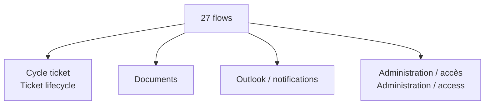

# Catalogue des automatisations / Automation Catalogue

[← Projet / Project](../README.md)

🇫🇷 Les **27 flows** se comprennent plus facilement par leur rôle métier que par leur nom technique.  
*🇬🇧 The **27 flows** are easier to understand by business responsibility than by technical name.*

## 1. Cycle ticket / Ticket lifecycle

🇫🇷 Brouillons, soumission initiale, actions ticket, routage et KPI service.  
*🇬🇧 Drafts, initial submission, ticket actions, routing and service KPIs.*

## 2. Documents / Documents

🇫🇷 Staging, lecture, suppression, rattachement final et maintenance documentaire.  
*🇬🇧 Staging, reading, deletion, final attachment and document maintenance.*

## 3. Outlook & notifications

🇫🇷 Recherche de messages, archivage/synchronisation de conversations et notifications d’affectation ou de copie.  
*🇬🇧 Message search, conversation archive/synchronisation and assignment/copy notifications.*

## 4. Administration / Administration

🇫🇷 Paramètres, équipes, accès, routage, délégations, favoris SharePoint et rétention.  
*🇬🇧 Settings, teams, access, routing, delegations, SharePoint favourites and retention.*

<strong>Noms techniques / Technical names</strong>

- PA_BrouillonsTicket_V1
- PA_ActionsTicket
- PA_InitialiserTransmissionTicket
- PA_MoteurRoutageTickets
- PA_KPITicketsService_V1
- PA_DocumentStaging_V1
- PA_DocumentsListerStaging_V1
- PA_DocumentsSupprimerPieceStaging_V1
- PA_DocumentsTicket_V2
- PA_MaintenanceDocuments
- PA_Outlook_RechercherMessages_V1
- PA_RattacherConversationOutlook
- PA_SynchroniserConversationsOutlook
- PA_Mail_DetecterNouveauxDocuments
- PA_Mail_GererAffectation
- PA_Mail_EnvoyerNotifications
- PA_Mail_CreerNotificationsHistorique
- PA_Mail_NotifierAjoutCopie
- PA_AjouterCopiesTicket_V2
- PA_AdministrationParametres_V1
- PA_AdministrationAccesEquipes_V1
- PA_AdministrationNotifications_V1
- PA_AdministrationReglesRoutage_V1
- PA_ProfilAbsencesDelegations_V1
- PA_FavorisNavigateurSharePoint_V1
- PA_Graph_NavigateurSharePoint_V2
- PA_ArchivageRetentionTickets

