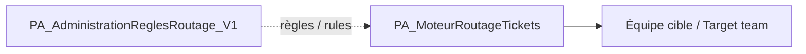
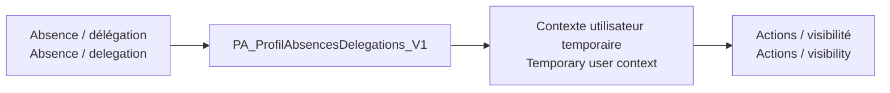
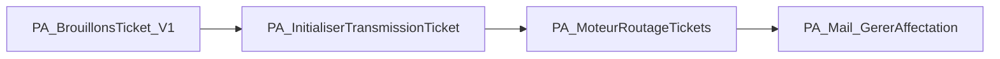
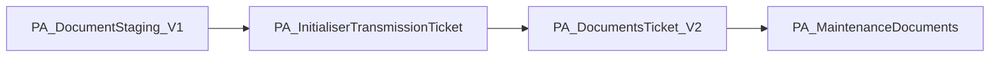
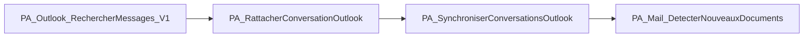
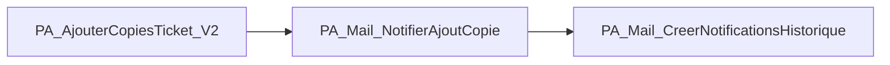
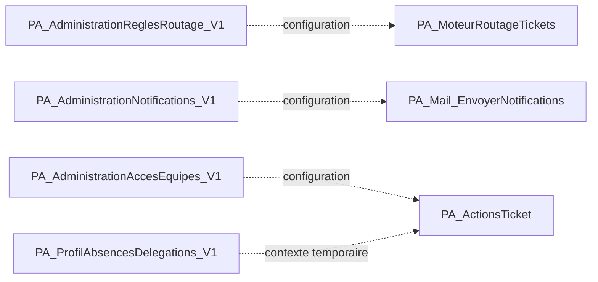

# Catalogue complet des automatisations / Full Automation Catalogue

[← Projet / Project](../README.md) · [📚 Index](./README.md) · [Architecture](./ARCHITECTURE.md) · [Parcours utilisateur / User journey](./USER_JOURNEY.md) · [Délégation / Delegation](./DELEGATION_SYSTEM.md)

> 🇫🇷 Cette page décrit les **27 flows Power Automate** du projet, leur rôle, leur ordre logique, leurs dépendances fonctionnelles et ce qui se passe si l’un d’eux ne fonctionne plus.  
> *🇬🇧 This page describes the project’s **27 Power Automate flows**, their role, logical order, functional dependencies and what happens if one of them stops working.*

---

# 1. Comment lire les dépendances / How to read dependencies

🇫🇷 La version publique du portfolio n’expose pas les expressions internes complètes ni tous les appels `Run a child flow`. Pour éviter d’inventer, les dépendances ci-dessous sont classées en trois niveaux.  
*🇬🇧 The public portfolio does not expose the complete internal expressions or every `Run a child flow` call. To avoid inventing implementation details, dependencies are classified into three levels.*

| Type | Français | English |
|---|---|---|
| **Enchaînement métier** | Le résultat du flow A est nécessaire pour que l’étape B ait du sens | Flow A’s result is required for business step B |
| **Dépendance donnée/config** | Le flow lit une donnée ou règle produite/gérée ailleurs | The flow reads data or configuration maintained elsewhere |
| **Autonome** | Le flow travaille sur la même solution mais peut s’exécuter sans appeler les autres | The flow belongs to the same solution but can operate independently |

---

# 2. Vue globale des 27 flows / Global map of the 27 flows

```mermaid
flowchart TB

    subgraph TICKET[Cycle du ticket / Ticket lifecycle]
      F1[PA_BrouillonsTicket_V1]
      F2[PA_InitialiserTransmissionTicket]
      F3[PA_MoteurRoutageTickets]
      F4[PA_ActionsTicket]
      F5[PA_KPITicketsService_V1]
    end

    subgraph DOCS[Documents]
      D1[PA_DocumentStaging_V1]
      D2[PA_DocumentsListerStaging_V1]
      D3[PA_DocumentsSupprimerPieceStaging_V1]
      D4[PA_DocumentsTicket_V2]
      D5[PA_MaintenanceDocuments]
    end

    subgraph MAIL[Outlook / notifications]
      M1[PA_Outlook_RechercherMessages_V1]
      M2[PA_RattacherConversationOutlook]
      M3[PA_SynchroniserConversationsOutlook]
      M4[PA_Mail_DetecterNouveauxDocuments]
      M5[PA_Mail_GererAffectation]
      M6[PA_Mail_EnvoyerNotifications]
      M7[PA_Mail_CreerNotificationsHistorique]
      M8[PA_Mail_NotifierAjoutCopie]
      M9[PA_AjouterCopiesTicket_V2]
    end

    subgraph ADMIN[Administration / access]
      A1[PA_AdministrationParametres_V1]
      A2[PA_AdministrationAccesEquipes_V1]
      A3[PA_AdministrationNotifications_V1]
      A4[PA_AdministrationReglesRoutage_V1]
      A5[PA_ProfilAbsencesDelegations_V1]
      A6[PA_FavorisNavigateurSharePoint_V1]
      A7[PA_Graph_NavigateurSharePoint_V2]
      A8[PA_ArchivageRetentionTickets]
    end

    F1 --> F2
    D1 --> F2
    F2 --> F3
    F2 --> D4
    F3 --> M5
    F4 --> M5
    F4 --> M6
    M9 --> M8
    M1 --> M2
    M2 --> M3
    M3 --> M4
    A7 --> A6

    A4 -. règles de routage / routing rules .-> F3
    A3 -. règles de notification / notification rules .-> M6
    A2 -. droits / team access .-> F4
    A5 -. contexte utilisateur / user context .-> F4
    F2 -. ticket créé / ticket created .-> F5
    F4 -. statuts mis à jour / status updates .-> F5
    D4 -. documents ticket .-> D5
    A8 -. tickets clôturés / closed tickets .-> F4
```

---

# 3. Parcours complet d’une demande / Complete request journey

```mermaid
flowchart LR
    A[Création dans Power Apps<br/>Creation in Power Apps]
    --> B[PA_BrouillonsTicket_V1]
    --> C[PA_DocumentStaging_V1 si PJ<br/>if documents]
    --> D[PA_InitialiserTransmissionTicket]
    --> E[PA_MoteurRoutageTickets]
    --> F[Équipe cible<br/>Target team]
    --> G[PA_Mail_GererAffectation]
    --> H[PA_ActionsTicket]
    --> I[Notifications / historique<br/>Notifications / history]
    --> J[Clôture<br/>Closure]
    --> K[PA_ArchivageRetentionTickets]
```

🇫🇷 Le parcours n’est pas obligatoirement un appel direct flow → flow. Il représente l’ordre métier dans lequel les données produites par une étape sont utilisées par la suivante.  
*🇬🇧 This journey does not necessarily mean direct flow-to-flow calls. It represents the business order in which one step’s data is used by the next.*

---

# 4. Flows du cycle ticket / Ticket lifecycle flows

## 4.1 PA_BrouillonsTicket_V1

**Rôle / Role**  
🇫🇷 Gère la vie d’un brouillon avant soumission finale : création, sauvegarde, reprise et suppression selon le parcours de l’application.  
*🇬🇧 Manages a draft before final submission: creation, save, resume and deletion according to the application journey.*

**Déclenchement métier / Business entry point**  
🇫🇷 Appelé depuis le parcours de création lorsqu’un utilisateur sauvegarde ou reprend un brouillon.  
*🇬🇧 Used from the creation journey when a user saves or resumes a draft.*

**Entrées / Inputs**
- contexte utilisateur / user context
- type de demande / request type
- valeurs du formulaire / form values
- identifiant de brouillon lorsqu’il existe / draft identifier when available

**Écrit / Writes**  
🇫🇷 Les données du brouillon et son état de préparation.  
*🇬🇧 Draft data and preparation state.*

**Dépendances**
- **Donnée/config :** profil utilisateur et règles d’accès disponibles dans l’application.
- **Fonctionnelle en aval :** `PA_InitialiserTransmissionTicket` a besoin des données finales issues du brouillon lorsqu’il est soumis.
- **Documents :** `PA_DocumentStaging_V1` peut fonctionner pendant que le ticket est encore un brouillon.

**Flows qui dépendent fonctionnellement de lui**
- `PA_InitialiserTransmissionTicket`

**Si ce flow tombe / Failure impact**  
🇫🇷 L’utilisateur ne peut plus sauvegarder/reprendre correctement un brouillon, mais les tickets déjà soumis restent indépendants.  
*🇬🇧 Users can no longer reliably save/resume drafts, but already submitted tickets remain independent.*

---

## 4.2 PA_InitialiserTransmissionTicket

**Rôle / Role**  
🇫🇷 Transforme la préparation utilisateur en **vrai ticket soumis**. C’est la frontière entre brouillon et demande opérationnelle.  
*🇬🇧 Turns user preparation into a **real submitted ticket**. This is the boundary between draft and operational request.*

**Déclenchement métier / Business entry point**  
🇫🇷 Confirmation finale sur l’écran de vérification.  
*🇬🇧 Final confirmation on the review screen.*

**Entrées / Inputs**
- données du brouillon / draft data
- demandeur / requester
- type de demande / request type
- documents stagés éventuels / staged documents if any

**Écrit / Writes**
- ticket opérationnel / operational ticket
- identifiant définitif / final identifier
- statut initial / initial status
- contexte nécessaire au routage / routing context

**Dépendances**
- **Amont :** `PA_BrouillonsTicket_V1`
- **Amont document :** `PA_DocumentStaging_V1`
- **Aval fonctionnel :** `PA_MoteurRoutageTickets`
- **Aval document :** `PA_DocumentsTicket_V2`

**Flows dépendants**
- `PA_MoteurRoutageTickets`
- `PA_DocumentsTicket_V2`
- `PA_KPITicketsService_V1` commence à voir le ticket une fois créé

**Si ce flow tombe / Failure impact**  
🇫🇷 Le ticket n’entre pas dans le processus opérationnel. Le brouillon peut exister, mais aucune vraie transmission n’a lieu.  
*🇬🇧 The ticket does not enter the operational process. A draft may exist, but no true submission occurs.*

---

## 4.3 PA_MoteurRoutageTickets

**Rôle / Role**  
🇫🇷 Détermine l’équipe ou le périmètre cible du ticket à partir des règles de routage.  
*🇬🇧 Determines the target team or scope using routing rules.*

**Entrées / Inputs**
- ticket soumis / submitted ticket
- type de demande / request type
- service/département/contexte / service/department/context
- règles de routage actives / active routing rules

**Lit / Reads**
- `PA_AdministrationReglesRoutage_V1` gère les règles consommées par ce moteur

**Écrit / Writes**
- équipe cible / target team
- données d’affectation initiale / initial assignment data
- résultat de routage / routing result

**Dépendances**
- **Amont :** `PA_InitialiserTransmissionTicket`
- **Configuration :** `PA_AdministrationReglesRoutage_V1`
- **Aval :** `PA_Mail_GererAffectation`
- **Aval KPI :** `PA_KPITicketsService_V1`

**Si ce flow tombe / Failure impact**  
🇫🇷 Le ticket peut exister mais rester sans équipe cible correcte. C’est un point critique du processus.  
*🇬🇧 The ticket may exist but remain without the correct target team. This is a critical process point.*

---

## 4.4 PA_ActionsTicket

**Rôle / Role**  
🇫🇷 Centralise les actions métier sur un ticket déjà créé : prise en charge, réaffectation, changement de statut et autres mutations contrôlées du cycle de vie.  
*🇬🇧 Centralises business actions on an existing ticket: ownership, reassignment, status changes and other controlled lifecycle mutations.*

**Entrées / Inputs**
- ticket
- utilisateur courant / current user
- action demandée / requested action
- commentaire ou contexte associé / comment or related context

**Dépendances données/config**
- `PA_AdministrationAccesEquipes_V1` pour le contexte d’accès équipe
- `PA_ProfilAbsencesDelegations_V1` lorsque le contexte utilisateur est affecté par une absence/délégation
- paramètres généraux selon l’action / general settings depending on action

**Aval / Downstream**
- `PA_Mail_GererAffectation` lors d’une affectation/réaffectation
- `PA_Mail_EnvoyerNotifications` pour les événements notifiables
- `PA_KPITicketsService_V1` lit ensuite les nouveaux statuts

**Si ce flow tombe / Failure impact**  
🇫🇷 Les tickets existent mais les équipes ne peuvent plus faire évoluer correctement leur état opérationnel.  
*🇬🇧 Tickets still exist, but teams can no longer reliably progress their operational state.*

---

## 4.5 PA_KPITicketsService_V1

**Rôle / Role**  
🇫🇷 Produit ou agrège les indicateurs nécessaires aux vues statistiques/service : charge, états, backlog, urgence, prise en charge.  
*🇬🇧 Produces or aggregates indicators for statistics/service views: workload, status, backlog, urgency and ownership.*

**Lit / Reads**
- tickets soumis
- statuts
- équipes
- dates
- urgence / priorité

**Dépendances**
- **Pas de dépendance d’appel obligatoire** vers les autres flows.
- **Dépendance donnée :** la qualité des KPI dépend des données écrites par `PA_InitialiserTransmissionTicket`, `PA_MoteurRoutageTickets` et `PA_ActionsTicket`.

**Si ce flow tombe / Failure impact**  
🇫🇷 Le processus ticket peut continuer, mais les statistiques deviennent indisponibles ou obsolètes.  
*🇬🇧 The ticket process can continue, but statistics become unavailable or stale.*

---

# 5. Flows documents / Document flows

## 5.1 PA_DocumentStaging_V1

**Rôle / Role**  
🇫🇷 Enregistre temporairement les documents pendant la création avant que le ticket définitif existe.  
*🇬🇧 Temporarily stores documents during creation before the final ticket exists.*

**Pourquoi il existe / Why it exists**  
🇫🇷 L’ajout d’un document ne doit pas créer ni soumettre un ticket.  
*🇬🇧 Adding a document must not create or submit a ticket.*

**Dépendances**
- travaille avec `PA_BrouillonsTicket_V1`
- prépare les données que `PA_DocumentsTicket_V2` utilisera après soumission

**Si ce flow tombe**  
🇫🇷 La création peut continuer sans document, mais le staging de pièces jointes n’est plus fiable.  
*🇬🇧 Creation can continue without documents, but attachment staging is no longer reliable.*

---

## 5.2 PA_DocumentsListerStaging_V1

**Rôle / Role**  
🇫🇷 Retourne à Power Apps la liste des documents préparés avant soumission.  
*🇬🇧 Returns the list of pre-submission staged documents to Power Apps.*

**Dépendances**
- dépend des documents créés par `PA_DocumentStaging_V1`
- autonome par rapport au cycle de routage

**Si ce flow tombe**  
🇫🇷 Les fichiers peuvent exister en staging mais ne plus être correctement affichés dans l’application.  
*🇬🇧 Files may still exist in staging but no longer display correctly in the app.*

---

## 5.3 PA_DocumentsSupprimerPieceStaging_V1

**Rôle / Role**  
🇫🇷 Supprime une pièce du staging avant soumission.  
*🇬🇧 Removes an item from staging before submission.*

**Dépendances**
- agit sur les éléments créés par `PA_DocumentStaging_V1`
- l’application doit rafraîchir/recharger la liste via `PA_DocumentsListerStaging_V1`

**Si ce flow tombe**  
🇫🇷 L’utilisateur peut ajouter mais ne plus retirer proprement une pièce avant soumission.  
*🇬🇧 The user may be able to add but no longer reliably remove an attachment before submission.*

---

## 5.4 PA_DocumentsTicket_V2

**Rôle / Role**  
🇫🇷 Gère les documents lorsque le ticket définitif existe : rattachement, transfert depuis staging et opérations documentaires liées au ticket.  
*🇬🇧 Manages documents once the final ticket exists: attachment, staging transfer and ticket-related document operations.*

**Dépendances**
- **Amont :** `PA_InitialiserTransmissionTicket` pour obtenir le ticket définitif
- **Amont documents :** `PA_DocumentStaging_V1`
- **Aval maintenance :** `PA_MaintenanceDocuments`

**Si ce flow tombe**  
🇫🇷 Le ticket peut être créé mais les pièces préparées risquent de ne pas être transférées/rattachées correctement.  
*🇬🇧 The ticket may be created, but prepared attachments may not be transferred/linked correctly.*

---

## 5.5 PA_MaintenanceDocuments

**Rôle / Role**  
🇫🇷 Traite les opérations de maintenance documentaire : cohérence, nettoyage ou réparation des liens/documents selon les règles du projet.  
*🇬🇧 Handles document maintenance operations: consistency, cleanup or repair of document links/files according to project rules.*

**Dépendances**
- lit les documents déjà gérés par `PA_DocumentsTicket_V2`
- autonome par rapport à la création instantanée d’un ticket

**Si ce flow tombe**  
🇫🇷 Le fonctionnement quotidien peut continuer, mais les anomalies documentaires ne sont plus automatiquement maintenues.  
*🇬🇧 Daily operations can continue, but document anomalies are no longer automatically maintained.*

---

# 6. Outlook, copies et notifications / Outlook, copies and notifications

## 6.1 PA_Outlook_RechercherMessages_V1

**Rôle / Role**  
🇫🇷 Recherche les messages Outlook qu’un utilisateur souhaite rattacher au ticket.  
*🇬🇧 Searches Outlook messages that a user wants to link to a ticket.*

**Dépendances**
- autonome jusqu’au choix utilisateur
- **Aval :** `PA_RattacherConversationOutlook`

**Si ce flow tombe**  
🇫🇷 L’utilisateur ne peut plus rechercher facilement les messages depuis l’application.  
*🇬🇧 Users can no longer easily search messages from the application.*

---

## 6.2 PA_RattacherConversationOutlook

**Rôle / Role**  
🇫🇷 À partir d’un message sélectionné, rattache/archive la conversation métier avec le ticket.  
*🇬🇧 Starting from a selected message, links/archives the business conversation with the ticket.*

**Amont**
- `PA_Outlook_RechercherMessages_V1`

**Aval**
- `PA_SynchroniserConversationsOutlook`
- documents/pièces jointes peuvent ensuite être repris dans le sous-système documentaire

**Si ce flow tombe**  
🇫🇷 La recherche Outlook fonctionne encore, mais le rattachement au ticket n’est plus possible.  
*🇬🇧 Outlook search may still work, but linking the conversation to the ticket no longer works.*

---

## 6.3 PA_SynchroniserConversationsOutlook

**Rôle / Role**  
🇫🇷 Met à jour une conversation déjà rattachée afin que les nouveaux messages restent visibles dans l’archive du ticket.  
*🇬🇧 Updates an already linked conversation so new messages remain visible in the ticket archive.*

**Amont**
- conversation déjà créée par `PA_RattacherConversationOutlook`

**Aval**
- `PA_Mail_DetecterNouveauxDocuments`

**Si ce flow tombe**  
🇫🇷 La conversation initiale reste archivée mais les nouveaux messages ne sont plus synchronisés automatiquement.  
*🇬🇧 The initial conversation remains archived, but new messages are no longer automatically synchronised.*

---

## 6.4 PA_Mail_DetecterNouveauxDocuments

**Rôle / Role**  
🇫🇷 Détecte les nouvelles pièces/documentations apparues dans les conversations suivies afin qu’elles puissent être prises en compte côté ticket/documentation.  
*🇬🇧 Detects new attachments/documents appearing in monitored conversations so they can be handled in the ticket/document subsystem.*

**Dépendances**
- `PA_SynchroniserConversationsOutlook`
- sous-système documents selon la règle métier

**Si ce flow tombe**  
🇫🇷 Les nouveaux messages peuvent être synchronisés mais les nouvelles pièces ne sont plus détectées automatiquement.  
*🇬🇧 New messages may still synchronise, but new attachments are no longer automatically detected.*

---

## 6.5 PA_Mail_GererAffectation

**Rôle / Role**  
🇫🇷 Gère la partie messagerie liée à une affectation ou réaffectation.  
*🇬🇧 Handles the messaging side of assignment or reassignment.*

**Amont**
- `PA_MoteurRoutageTickets` pour l’affectation initiale
- `PA_ActionsTicket` pour les réaffectations ultérieures

**Aval**
- peut utiliser `PA_Mail_EnvoyerNotifications` comme couche de diffusion logique
- historique via `PA_Mail_CreerNotificationsHistorique`

**Si ce flow tombe**  
🇫🇷 L’affectation métier peut être enregistrée mais la communication associée risque de ne pas partir.  
*🇬🇧 The business assignment may still be recorded, but related communication may not be sent.*

---

## 6.6 PA_Mail_EnvoyerNotifications

**Rôle / Role**  
🇫🇷 Centralise l’envoi des notifications métier lorsque le projet doit informer un demandeur, une équipe ou un responsable.  
*🇬🇧 Centralises business notification delivery when the project needs to inform a requester, team or owner.*

**Configuration**
- `PA_AdministrationNotifications_V1`

**Sources d’événements / Event sources**
- `PA_ActionsTicket`
- affectations/réaffectations
- événements documentés du cycle ticket

**Aval**
- `PA_Mail_CreerNotificationsHistorique`

**Si ce flow tombe**  
🇫🇷 Les données peuvent continuer à évoluer mais les utilisateurs ne reçoivent plus les notifications prévues.  
*🇬🇧 Data may continue to change, but users no longer receive expected notifications.*

---

## 6.7 PA_Mail_CreerNotificationsHistorique

**Rôle / Role**  
🇫🇷 Conserve une trace de la notification : événement, cible et contexte utile au suivi.  
*🇬🇧 Keeps a trace of notifications: event, recipient and context useful for monitoring.*

**Dépendances**
- en aval logique de `PA_Mail_EnvoyerNotifications`
- peut recevoir aussi les événements spécifiques d’affectation/copie

**Si ce flow tombe**  
🇫🇷 Les e-mails peuvent être envoyés mais la traçabilité des notifications devient incomplète.  
*🇬🇧 E-mails may still be sent, but notification traceability becomes incomplete.*

---

## 6.8 PA_Mail_NotifierAjoutCopie

**Rôle / Role**  
🇫🇷 Informe une personne lorsqu’elle est ajoutée en copie d’un ticket.  
*🇬🇧 Notifies a person when they are added as a copy/CC on a ticket.*

**Amont**
- `PA_AjouterCopiesTicket_V2`

**Si ce flow tombe**  
🇫🇷 La personne peut être enregistrée en copie sans recevoir l’information associée.  
*🇬🇧 A person may still be stored as a copy/CC without receiving the related notification.*

---

## 6.9 PA_AjouterCopiesTicket_V2

**Rôle / Role**  
🇫🇷 Ajoute ou met à jour les personnes en copie sur le ticket.  
*🇬🇧 Adds or updates people copied on a ticket.*

**Aval**
- `PA_Mail_NotifierAjoutCopie`

**Dépendances données**
- ticket existant
- identité M365 de la personne sélectionnée

**Si ce flow tombe**  
🇫🇷 L’ajout de copies depuis l’application ne fonctionne plus correctement.  
*🇬🇧 Adding copied users from the application no longer works reliably.*

---

# 7. Administration, accès et configuration / Administration, access and configuration

## 7.1 PA_AdministrationParametres_V1

**Rôle / Role**  
🇫🇷 Gère les paramètres généraux utilisés par l’application et certains flows.  
*🇬🇧 Manages general settings used by the application and some flows.*

**Type de dépendance**
- fournisseur de configuration / configuration provider
- pas nécessairement appelé directement par tous les flows consommateurs

**Si ce flow tombe**  
🇫🇷 Les paramètres deviennent difficiles à maintenir depuis l’application d’administration.  
*🇬🇧 Settings become difficult to maintain from the administration interface.*

---

## 7.2 PA_AdministrationAccesEquipes_V1

**Rôle / Role**  
🇫🇷 Gère les relations utilisateur ↔ équipe ↔ droits nécessaires aux vues et actions métier.  
*🇬🇧 Manages user ↔ team ↔ access relationships needed by views and business actions.*

**Consommateurs fonctionnels**
- Power Apps
- `PA_ActionsTicket`
- logique de ticket service
- administration

**Si ce flow tombe**  
🇫🇷 La gestion des accès équipe devient incohérente ou impossible à maintenir.  
*🇬🇧 Team-access management becomes inconsistent or impossible to maintain.*

---

## 7.3 PA_AdministrationNotifications_V1

**Rôle / Role**  
🇫🇷 Gère les règles/paramètres contrôlant quelles notifications doivent être actives.  
*🇬🇧 Manages rules/settings controlling which notifications are enabled.*

**Consommateur principal**
- `PA_Mail_EnvoyerNotifications`

**Si ce flow tombe**  
🇫🇷 Les réglages de notification ne peuvent plus être maintenus proprement.  
*🇬🇧 Notification settings can no longer be maintained reliably.*

---

## 7.4 PA_AdministrationReglesRoutage_V1

**Rôle / Role**  
🇫🇷 Gère les règles utilisées pour déterminer quelle équipe doit recevoir quelle demande.  
*🇬🇧 Manages rules used to decide which team should receive which request.*

**Consommateur principal**
- `PA_MoteurRoutageTickets`

**Dépendance critique**

**Si ce flow tombe**  
🇫🇷 Les règles existantes peuvent encore être lues si elles sont stockées, mais leur administration devient indisponible.  
*🇬🇧 Existing stored rules may still be readable, but administration of those rules becomes unavailable.*

---

## 7.5 PA_ProfilAbsencesDelegations_V1

**[→ Documentation complète du système de délégation / Complete delegation-system documentation](./DELEGATION_SYSTEM.md)**

**Rôle / Role**  
🇫🇷 Gère le profil, les absences et les délégations temporaires.  
*🇬🇧 Manages profile information, absences and temporary delegations.*

**Pourquoi c’est séparé / Why it is separate**  
🇫🇷 Une délégation est temporaire et doit garder une période et une trace ; elle ne doit pas devenir un changement permanent de rôle.  
*🇬🇧 A delegation is temporary and should keep a period and trace; it should not become a permanent role change.*

**Consommateurs fonctionnels**
- Power Apps
- contexte utilisateur de `PA_ActionsTicket`
- logique d’accès et de visibilité

**Dépendance**

**Si ce flow tombe**  
🇫🇷 Les droits permanents ne sont pas nécessairement perdus, mais le remplacement temporaire n’est plus géré correctement.  
*🇬🇧 Permanent rights are not necessarily lost, but temporary replacement is no longer managed correctly.*

---

## 7.6 PA_FavorisNavigateurSharePoint_V1

**Rôle / Role**  
🇫🇷 Enregistre et retire les favoris du navigateur documentaire SharePoint.  
*🇬🇧 Adds and removes favourites in the SharePoint document navigator.*

**Amont fonctionnel**
- `PA_Graph_NavigateurSharePoint_V2` fournit le contexte du fichier/dossier parcouru

**Si ce flow tombe**  
🇫🇷 Le navigateur continue de fonctionner, mais les favoris ne sont plus persistés correctement.  
*🇬🇧 The navigator can continue working, but favourites are no longer persisted reliably.*

---

## 7.7 PA_Graph_NavigateurSharePoint_V2

**Rôle / Role**  
🇫🇷 Sert de moteur de navigation documentaire : sites, dossiers, fichiers, recherche, pagination, retour parent et ouverture.  
*🇬🇧 Acts as the document-navigation engine: sites, folders, files, search, pagination, parent navigation and opening.*

**Aval**
- `PA_FavorisNavigateurSharePoint_V1` pour la persistance des favoris

**Autonomie**
🇫🇷 Ce flow est largement indépendant du cycle ticket ; il peut être utilisé comme composant documentaire transverse.  
*🇬🇧 This flow is largely independent from the ticket lifecycle and can be used as a cross-cutting document component.*

**Si ce flow tombe**  
🇫🇷 Le navigateur SharePoint intégré à l’application devient indisponible.  
*🇬🇧 The integrated SharePoint navigator becomes unavailable.*

---

## 7.8 PA_ArchivageRetentionTickets

**Rôle / Role**  
🇫🇷 Gère l’archivage/rétention des tickets selon leur âge, statut ou règles de conservation.  
*🇬🇧 Handles ticket archiving/retention according to age, status or retention rules.*

**Entrées / Inputs**
- tickets clôturés
- dates
- règles de rétention

**Dépendances**
- **Donnée :** statuts produits par le cycle ticket
- **Pas de dépendance temps réel** nécessaire pour créer/traiter un ticket

**Si ce flow tombe**  
🇫🇷 Les opérations courantes continuent mais l’archivage/rétention n’est plus automatisé.  
*🇬🇧 Daily operations continue, but archiving/retention is no longer automated.*

---

# 8. Dépendances principales par flow / Main dependencies by flow

| Flow | Dépend de / Depends on | Alimente / Feeds |
|---|---|---|
| PA_BrouillonsTicket_V1 | contexte Power Apps | PA_InitialiserTransmissionTicket |
| PA_InitialiserTransmissionTicket | Brouillon + staging documents | Routage + documents ticket + KPI |
| PA_MoteurRoutageTickets | Ticket soumis + règles routage | Affectation + KPI |
| PA_ActionsTicket | Ticket + accès équipes + délégation | Notifications + affectation + KPI |
| PA_KPITicketsService_V1 | Données tickets/statuts | Dashboards/statistiques |
| PA_DocumentStaging_V1 | Création/brouillon | DocumentsTicket_V2 |
| PA_DocumentsListerStaging_V1 | DocumentStaging | Power Apps |
| PA_DocumentsSupprimerPieceStaging_V1 | DocumentStaging | Liste staging mise à jour |
| PA_DocumentsTicket_V2 | Ticket final + staging | MaintenanceDocuments |
| PA_MaintenanceDocuments | Documents ticket | Cohérence documentaire |
| PA_Outlook_RechercherMessages_V1 | Outlook | RattacherConversationOutlook |
| PA_RattacherConversationOutlook | Recherche Outlook + ticket | SynchroniserConversationsOutlook |
| PA_SynchroniserConversationsOutlook | Conversation rattachée | DetecterNouveauxDocuments |
| PA_Mail_DetecterNouveauxDocuments | Conversation synchronisée | Sous-système documents |
| PA_Mail_GererAffectation | Routage / ActionsTicket | Notifications / historique |
| PA_Mail_EnvoyerNotifications | Événements + config notifications | Historique notifications |
| PA_Mail_CreerNotificationsHistorique | Notifications | Audit notification |
| PA_Mail_NotifierAjoutCopie | AjouterCopiesTicket | Utilisateur copié |
| PA_AjouterCopiesTicket_V2 | Ticket + identité M365 | NotifierAjoutCopie |
| PA_AdministrationParametres_V1 | Administration | App + flows consommateurs |
| PA_AdministrationAccesEquipes_V1 | Administration | ActionsTicket + vues équipe |
| PA_AdministrationNotifications_V1 | Administration | EnvoyerNotifications |
| PA_AdministrationReglesRoutage_V1 | Administration | MoteurRoutageTickets |
| PA_ProfilAbsencesDelegations_V1 | Profil utilisateur | Actions/visibilité temporaire |
| PA_FavorisNavigateurSharePoint_V1 | Navigateur SharePoint | Favoris utilisateur |
| PA_Graph_NavigateurSharePoint_V2 | Microsoft Graph / SharePoint | Power Apps + Favoris |
| PA_ArchivageRetentionTickets | Tickets clôturés + règles rétention | Archivage / conservation |

---

# 9. Chemins critiques / Critical paths

## Soumission d’un ticket / Ticket submission

🇫🇷 Si un de ces flows échoue, la création peut être visible côté utilisateur mais le ticket risque de ne pas arriver correctement dans la file opérationnelle.  
*🇬🇧 If one of these flows fails, creation may appear successful to the user while the ticket may not reach the operational queue correctly.*

## Documents / Documents

## Outlook / Outlook

## Copies / CC

## Administration → exécution / Administration → runtime

---

# 10. Résumé pour quelqu’un qui veut auditer le projet / Summary for a full project reviewer

🇫🇷 Le projet n’est pas composé de 27 flows indépendants placés au hasard. Il est organisé autour de **quatre sous-systèmes** :  
*🇬🇧 The project is not made of 27 unrelated flows. It is organised around **four subsystems**:*

1. **Cycle ticket / Ticket lifecycle**  
   🇫🇷 crée, route et fait évoluer la demande.  
   *🇬🇧 creates, routes and progresses the request.*

2. **Documents**  
   🇫🇷 sépare le staging avant soumission des documents liés au ticket final.  
   *🇬🇧 separates pre-submission staging from final ticket documents.*

3. **Outlook & notifications**  
   🇫🇷 rattache les conversations, synchronise les échanges et informe les personnes concernées.  
   *🇬🇧 links conversations, synchronises exchanges and informs relevant users.*

4. **Administration & access**  
   🇫🇷 fournit les règles de routage, accès, notifications, délégations, navigation documentaire et rétention.  
   *🇬🇧 provides routing, access, notification, delegation, document-navigation and retention rules.*

🇫🇷 Le point central reste le **ticket** : les flows ne cherchent pas à remplacer l’application, mais à sécuriser, automatiser et tracer les opérations qui ne doivent pas reposer uniquement sur le client Power Apps.  
*🇬🇧 The central object remains the **ticket**: flows do not replace the application; they secure, automate and trace operations that should not rely only on the Power Apps client.*

---

> 🇫🇷 **Note de transparence :** cette documentation décrit l’architecture fonctionnelle et les dépendances exposables dans le portfolio. Les expressions internes, identifiants de listes, connexions, secrets et paramètres de production restent volontairement non publiés.  
> *🇬🇧 **Transparency note:** this documentation describes the functional architecture and dependencies suitable for the public portfolio. Internal expressions, list identifiers, connections, secrets and production parameters remain intentionally unpublished.*
