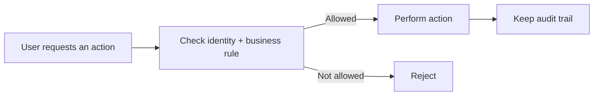
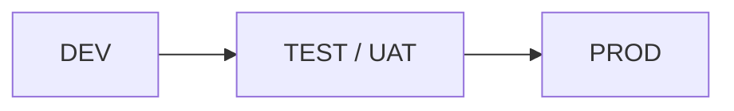
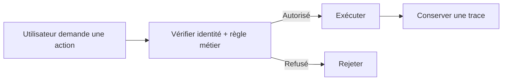

# Security & Governance — Ticketing

[← Project](../README.md)

---

## 🇬🇧 English

### Main rule

**A hidden button is not security.**

Sensitive actions should be checked where the data or automation is actually changed.

### Deployment

Changes should be tested before production, and environment-specific settings should not be hard-coded.

---

## 🇫🇷 Français

### Règle principale

**Cacher un bouton n’est pas une sécurité.**

Les actions sensibles doivent être vérifiées là où les données ou automatisations sont réellement modifiées.

### Déploiement

Les changements doivent être testés avant la production et les paramètres liés à l’environnement ne doivent pas être codés en dur.
