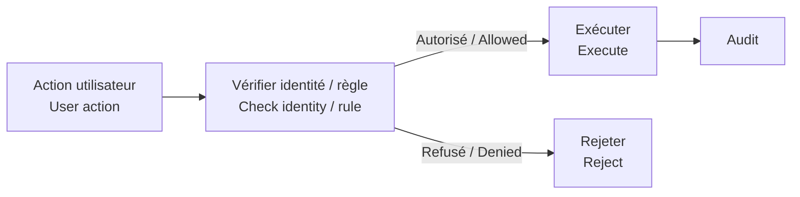
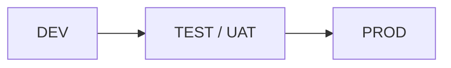

# Sécurité & gouvernance / Security & Governance

[← Projet / Project](../README.md)

## 🛡️ Principe principal / Main principle

> 🇫🇷 **Cacher un bouton n’est pas une sécurité.**  
> *🇬🇧 Hiding a button is not security.*

🇫🇷 Les actions sensibles doivent être revalidées au niveau SharePoint et/ou Power Automate.  
*🇬🇧 Sensitive actions should be revalidated at the SharePoint and/or Power Automate layer.*

## 🔁 Fiabilité / Reliability

- 🇫🇷 Branches d’erreur explicites et historique utile.  
  *🇬🇧 Explicit error paths and useful history.*
- 🇫🇷 Contrôle des répétitions et doublons lorsque nécessaire.  
  *🇬🇧 Duplicate/idempotency controls where needed.*
- 🇫🇷 Concurrence limitée aux tâches indépendantes.  
  *🇬🇧 Concurrency limited to independent tasks.*

## 🚀 Déploiement / Deployment

🇫🇷 Les variables d’environnement et références de connexion évitent de coder en dur les valeurs propres à chaque environnement.  
*🇬🇧 Environment variables and connection references avoid hard-coding environment-specific values.*
