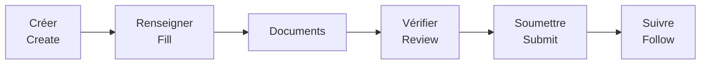
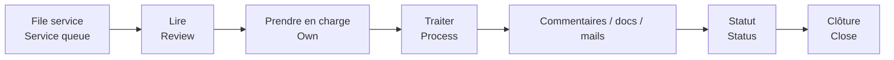
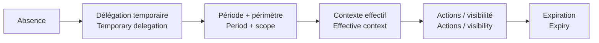

# Parcours utilisateurs / User Journeys

[← Projet / Project](../README.md) · [📚 Index](./README.md) · [Délégation / Delegation](./DELEGATION_SYSTEM.md)

## 👤 Demandeur / Requester

🇫🇷 Le demandeur suit un parcours guidé sans devoir connaître l’organisation interne.  
*🇬🇧 The requester follows a guided journey without needing to understand internal organisation.*

## 🧑‍🔧 Équipe opérationnelle / Operational team

## 🛠️ Administration / Administration

🇫🇷 Les administrateurs gèrent équipes, accès, délégations, routage, paramètres de notification et historique d’administration.  
*🇬🇧 Administrators manage teams, access, delegations, routing, notification settings and administration history.*

## 📝 Brouillons / Drafts

🇫🇷 Un brouillon est un travail non terminé et reste hors de la file opérationnelle avant la soumission finale.  
*🇬🇧 A draft is unfinished work and stays out of the operational queue until final submission.*

## 🔁 Absence & délégation / Absence & delegation

🇫🇷 Lorsqu’un utilisateur est absent, la délégation ajoute un **contexte temporaire** sans remplacer ses rôles permanents.  
*🇬🇧 When a user is unavailable, delegation adds **temporary context** without replacing permanent roles.*

**[→ Voir toutes les règles de délégation / See all delegation rules](./DELEGATION_SYSTEM.md)**
