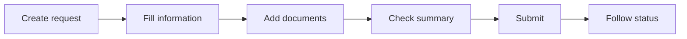
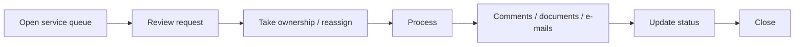
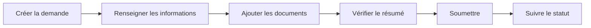
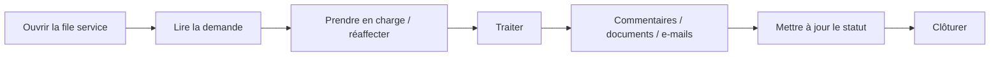

# User Journey — Ticketing

[← Project](../README.md)

---

## 🇬🇧 English

### Requester

### Operational team

### Administrator

Administrators manage teams, access, routing rules, temporary delegation, notifications and audit history.

### Why drafts matter

A draft is unfinished work. It should not enter the operational queue before final submission.

---

## 🇫🇷 Français

### Demandeur

### Équipe opérationnelle

### Administrateur

L’administrateur gère les équipes, accès, règles de routage, délégations temporaires, notifications et historique d’administration.

### Pourquoi les brouillons sont importants

Un brouillon est un travail non terminé. Il ne doit pas entrer dans la file opérationnelle avant la soumission finale.
