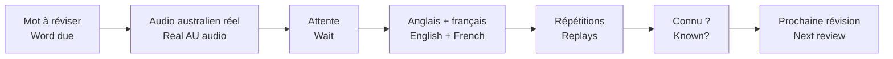
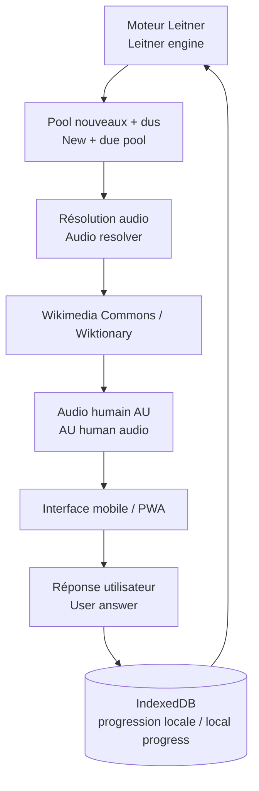

# RoadWords AU

[← Portfolio](../README.md)

> 🇫🇷 **Une application mobile de vocabulaire qui commence par l’écoute d’une vraie prononciation australienne avant d’afficher la traduction.**  
> *🇬🇧 A mobile vocabulary app that starts with real Australian pronunciation before revealing the translation.*

## ⚡ Comprendre en 30 secondes / Understand in 30 seconds

**🇫🇷 Problème :** lire des listes de vocabulaire aide peu à reconnaître les mots lorsqu’ils sont prononcés naturellement.  
*🇬🇧 Problem: reading vocabulary lists does little to help recognise words when they are naturally spoken.*

**🇫🇷 Solution :** écouter d’abord le mot, attendre, révéler anglais + français, réécouter plusieurs fois puis indiquer si le mot est connu.  
*🇬🇧 Solution: hear the word first, wait, reveal English + French, replay it several times and then mark whether the word is known.*

## 🎧 Boucle d’apprentissage / Learning loop

1. 🇫🇷 Le moteur choisit une carte nouvelle ou à réviser selon la répétition espacée.  
   *🇬🇧 The engine selects a new or due card using spaced repetition.*
2. 🇫🇷 L’application cherche un **enregistrement humain australien** réellement disponible.  
   *🇬🇧 The app resolves a genuinely available **Australian human recording**.*
3. 🇫🇷 Si aucun enregistrement australien n’est trouvé, la carte est ignorée plutôt que remplacée par une fausse équivalence.  
   *🇬🇧 If no Australian recording is found, the card is skipped rather than replaced by a fake equivalent.*
4. 🇫🇷 Le mot est joué, puis la traduction est révélée après le délai configuré.  
   *🇬🇧 The word is played, then the translation is revealed after the configured delay.*
5. 🇫🇷 Le même enregistrement est rejoué pour renforcer la reconnaissance sonore.  
   *🇬🇧 The same recording is replayed to reinforce sound recognition.*
6. 🇫🇷 La réponse connu / pas connu alimente la prochaine révision.  
   *🇬🇧 The known / not-known answer feeds the next review.*

## 🧩 Architecture / Architecture

## 🔊 Pourquoi l’audio est différent / Why the audio is different

🇫🇷 Le projet ne repose pas sur la voix TTS du navigateur pour les mots cibles. Il cherche des fichiers Wikimedia/Wiktionary explicitement associés à l’anglais australien lorsqu’ils existent.  
*🇬🇧 The project does not rely on browser TTS for target words. It looks for Wikimedia/Wiktionary files explicitly associated with Australian English when available.*

## 📱 Expérience mobile / Mobile experience

🇫🇷 L’utilisateur fait un premier appui pour autoriser l’audio sur iPhone, puis la session peut enchaîner les mots, révélations et répétitions.  
*🇬🇧 The user makes an initial tap to unlock audio on iPhone, then the session can sequence words, reveals and repetitions.*

🇫🇷 La progression est conservée localement afin de poursuivre les révisions sans créer un système de compte complexe.  
*🇬🇧 Progress is stored locally so reviews can continue without requiring a complex account system.*

## 🧱 Origine open source / Open-source foundation

🇫🇷 RoadWords AU est une adaptation du projet open source **Motamot** et conserve sa logique mobile/PWA et Leitner tout en modifiant la boucle d’apprentissage.  
*🇬🇧 RoadWords AU adapts the open-source **Motamot** project, keeping its mobile/PWA and Leitner foundation while changing the learning loop.*

**[Voir les informations upstream / See upstream information →](./UPSTREAM.md)**
