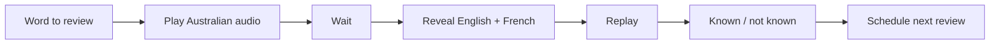
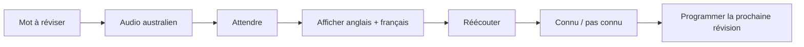

# RoadWords AU

[← Portfolio](../README.md)

---

## 🇬🇧 English

### 20-second overview

RoadWords AU is a mobile vocabulary trainer focused on **hearing real Australian pronunciation before reading the translation**.

### Why

The goal is to practise vocabulary as listening, not only as a written word list.

### Technical detail

The project adapts the open-source Motamot project and uses spaced repetition, local progress and Australian-tagged audio sources when available.

---

## 🇫🇷 Français

### Vue en 20 secondes

RoadWords AU est une application mobile de vocabulaire centrée sur **l’écoute d’une vraie prononciation australienne avant de lire la traduction**.

### Pourquoi

Le but est de travailler le vocabulaire comme un exercice d’écoute et pas uniquement comme une liste de mots écrits.
